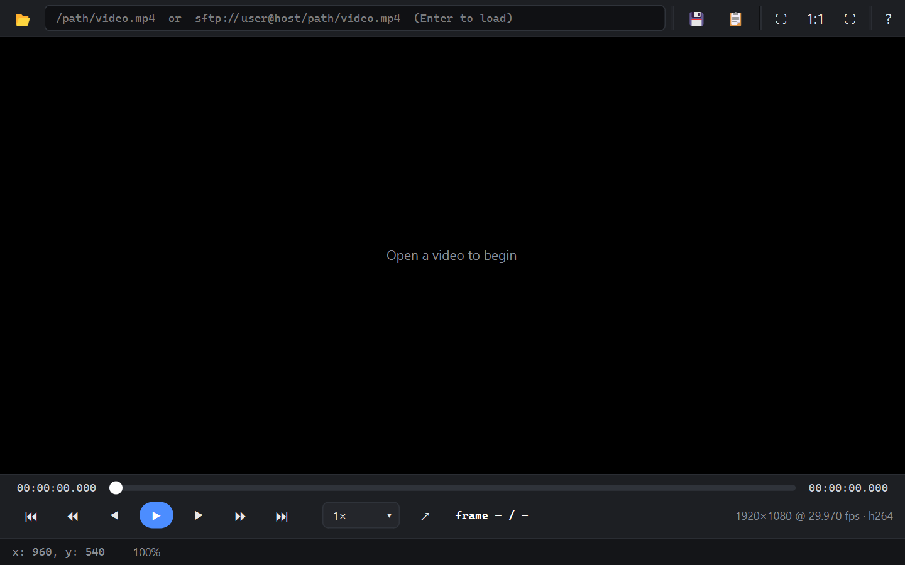

# VPlayer

Desktop video player for Windows 10/11 and Ubuntu 22.04 (in development).



## Development

Use Python 3.12 and FFmpeg for test media. From the repository root:

```sh
python -m venv .venv
python -m pip install -e ".[dev]"
```

On Windows, run `python scripts/fetch_libmpv.py` to download the pinned,
SHA-256-verified `libmpv-2.dll` into `vendor/`. The script needs Windows'
built-in `tar`.

On Ubuntu 22.04, run `sudo apt install libmpv1 libxcb-cursor0 libxcb-icccm4 libxcb-keysyms1 libxkbcommon-x11-0` instead.
For complete prerequisites, Windows/Ubuntu setup, test commands, build
artifacts, and known CI limitations, see [Setup and build](docs/SETUP.md).
For the native crash history and remaining investigation, see
[Native crash investigation](docs/CRASHES.md).
For open checklist items, dependencies, and release blockers, see
[Remaining work and blockers](docs/REMAINING_WORK.md).

Run `vplayer` or `python -m vplayer`, then click **Open File** or press
**Ctrl+O** to select a local video.
The file picker shows supported video types instead of unrelated files.
Typing a local directory into the path bar lists its video files; choose one
from the dropdown to play it.
The window starts with an Open file / Connect to server placeholder. **Ctrl+T**
opens a file in a new tab, **Ctrl+W** closes the active tab, and **Ctrl+Tab** /
**Ctrl+Shift+Tab** switch tabs. Closing the last tab restores the placeholder;
each tab keeps its own playback position, speed, volume and track selection.
**Ctrl+N** opens another window with its own tabs and playback.
Playback shortcuts affect only the active tab of the focused window.
Each window supports up to four tabs; a fifth request offers **Open in new
window** without replacing the current video.
By default, switching tabs or minimizing a window pauses playback; returning
resumes only videos that were playing before they became hidden. **File >
Preferences > Background tabs** can instead keep hidden tabs playing muted
or with audio; the choice applies to all open windows.
Use **Space** or the toolbar to play/pause (the button shows the next action);
click or drag the seek bar, or use
**Left/Right** (5 seconds) and **Shift+Left/Right** (60 seconds) to seek.
Use **Home/End** or the first/last-frame buttons to pause on a video boundary.
Use **Ctrl+0** to fit video to the window, **Ctrl+1** for actual pixels, and
**F11** to toggle fullscreen.
Click **?** to view the version and keyboard shortcuts; close
the help dialog with **Close** or **Esc**.
Use **Up/Down** for volume, **M** for mute, and **F** for fullscreen (**Esc**
to exit).
You can also run `vplayer FILE [FILE ...]` to open paths from the command line,
`vplayer --version` to print the version, or `vplayer --new-window FILE`.
External opens join the running app as tabs in its most recently focused window;
more than four tabs spill into another window. Use `--new-window` to open
the files in a separate window instead.
Use `vplayer sftp://user@host:port/path` to authenticate and play a remote
file without downloading a local copy. **File > Recent Files** reopens the
last 20 successfully loaded local or SFTP files, newest first. Remote entries
ask for authentication again unless a saved profile has a keyring secret;
passwords are never accepted in SFTP URIs or saved in recent items.
Use **Ctrl+B** to show or hide the local file browser; **All files** reveals
files outside the media extension filter. Double-click or press **Enter** on a
folder to open it, or on a video to play it.
The browser, video surface, seek bar, and Play/Pause toolbar button are
reachable with **Tab** and **Shift+Tab**; the focused video has a visible
outline. Preferences and SSH connection/host-key prompts also support
keyboard navigation with named controls.
Use **Alt+1** through **Alt+6** for playback speeds 0.25×, 0.5×, 0.67×, 1×, 2× and 4×;
the current speed appears in the status bar.
Use **]** / **[** to adjust speed by the configured step (default 0.05×), or
**Backspace** to return to 1×.
Audio pitch stays corrected at non-1× speed by default; uncheck
**File > Preferences > Preserve audio pitch when changing speed** to turn
correction off. The choice persists across launches.
To reopen local files at their last saved position, enable **File > Preferences >
Resume local files from the last position**. It is off by default; closing
the window or opening another file saves the current position when enabled.
Disabling it starts files from the beginning without erasing saved positions.
Choose an audio or embedded subtitle track from the **Audio** or
**Subtitles** menu; **A** and **J** cycle through their tracks and Off.
Set an A-B repeat segment from **Playback > Set loop start/end** at the current
position (**Ctrl+Alt+1/2**); **Ctrl+Alt+0** clears the loop. The seek bar marks
both points, and opening another file clears them.
Press **Ctrl+Shift+C** to copy the active tab's timestamp and frame number
(or just the timestamp when its frame rate is unknown) to the clipboard.
Press **.** to pause and advance one video frame.
Press **S** to save a native-resolution PNG named for the source, timestamp and
frame (when known); **Ctrl+Shift+S** opens Save As for PNG or JPEG. Snapshot
names are limited to 120 characters; repeated captures receive `_2`, `_3`, etc.

Generate the frame-indexed and codec/container media fixtures with
`python scripts/make_test_media.py` (requires FFmpeg and ffprobe), then
`python scripts/make_test_media.py --corrupt` for the deterministic 50-file
damaged-media corpus. The main generator also writes `tracks_multi.mkv` with
two audio and two subtitle tracks, plus `tracks_external.srt`. The corrupt
option uses the previously generated codec fixtures as inputs. Run
`python -m pytest -q`. Pytest's fault handler is disabled in this project:
the pinned Windows libmpv emits LuaJIT exceptions that can crash the test
process when the handler is installed.
For the SSH integration fixtures, start a local Docker Linux daemon and run
`python -m pytest -q -m sftp`; the tests build and remove a disposable OpenSSH
container automatically.
The SFTP connection dialog verifies unknown and changed SSH host keys before
authentication. Trust once applies only to the current connection; trust and
remember updates the application's known-hosts file without editing
`~/.ssh/known_hosts`. Remote playback retries socket errors and timeouts
without reloading the file, reauthenticating against the originally approved
host key. The tab header and window status bar show retry attempts or cache
buffering, including when another tab is active.
Retry count defaults to 6 (`network/retry_max`, 0–20); cancellation interrupts
connection attempts. Exhausted retries show the last playback time and a
**Retry** button; Retry reauthenticates and resumes from that time. SFTP
browsing is not yet exposed through the main window.
`SftpStream` reads remote files into one in-memory 4 MiB block using bounded
SFTP requests. Reads may stop at a block boundary; the mpv stream callback
supports remote playback in the `Player` facade.
The lazy `SftpDirModel` lists remote folders on a worker thread and displays
permission or missing-folder errors inline. It is not yet attached to the
main-window browser.
`ConnectDialog` can save, select, update and delete SSH connection profiles in
the INI settings file. Passwords and private-key passphrases are saved only
when opted in, in the OS keyring, never in the INI; a saved profile restores
the secret for subsequent connections when that keyring is available.
`parse_sftp_uri()` validates and decodes SFTP URIs without accepting passwords
in URLs; `ConnectDialog.for_sftp_uri()` selects one matching saved profile or
prefills a new connection. The CLI and Recent Files menu use this dialog to
connect before starting remote playback.
SSH aliases resolve HostName, Port, User and IdentityFile before connecting;
typed fields take precedence. Potentially executable `Match exec` blocks and
canonicalization directives are skipped; ignored settings appear in the
connection dialog without invoking a proxy or external command.
