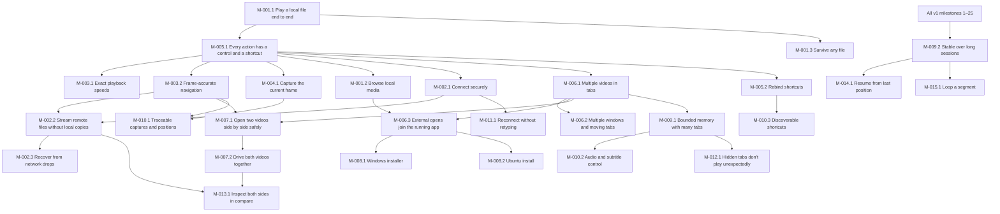

# Azure Task List: VPlayer (personal video player)

## Overview
- **Goal**: Build VPlayer, a Python (PySide6 + libmpv) video player for Windows 10/11 and Ubuntu 22.04 with local and zero-copy SFTP playback, exact speeds, frame-accurate stepping, snapshots, tabs/windows and synced compare, packaged with OS integration.
- **PRD**: [docs/prds/2026-10-11_video-player_prd.md](../prds/2026-10-11_video-player_prd.md) (Approved)
- **Technical design**: [2026-10-11_video-player_technical-design.md](2026-10-11_video-player_technical-design.md) · **Discovery**: [2026-10-11_video-player_discovery.md](2026-10-11_video-player_discovery.md)
- **Total Est. Manual**: 232:15 | **Total Est. AI**: 45:05 (v1 = Must + Should: 227:15 / 43:55; Could adds 05:00 / 01:10)
- **Items**: 119 (111 Tasks, 8 Debug spikes/triage, 0 Bugs) across 66 user stories, 28 milestones, 15 requirements

**Estimation rules**: User Story = Σ items; Feature = Σ stories; Milestone = Σ features + exit verification (01:00 manual / 00:15 AI); Requirement = Σ milestones. AI totals here are bottom-up per item (v1 43:55) and land close to the PRD's top-down v1 estimate (44:35); per-story values differ because scaffolding, CI, fixtures and spikes sit in the first story that needs them. Debug items marked "Only if…" are contingency; drop their time if the condition doesn't occur.

## Summary Rollup

| Requirement | Milestone | Est. Manual | Est. AI | Savings (%) |
|-------------|-----------|-------------|---------|-------------|
| REQ-001 (Must) | M-001.1 Play a local file end to end | 29:00 | 04:55 | ~83% |
| REQ-001 (Must) | M-001.2 Browse local media | 05:00 | 01:05 | ~78% |
| REQ-001 (Must) | M-001.3 Survive any file | 13:30 | 02:20 | ~83% |
| REQ-002 (Must) | M-002.1 Connect securely | 15:00 | 02:35 | ~83% |
| REQ-002 (Must) | M-002.2 Stream remote files without local copies | 18:00 | 03:10 | ~82% |
| REQ-002 (Must) | M-002.3 Recover from network drops | 09:30 | 01:45 | ~82% |
| REQ-003 (Must) | M-003.1 Exact playback speeds | 04:00 | 00:45 | ~81% |
| REQ-003 (Must) | M-003.2 Frame-accurate navigation | 17:15 | 03:20 | ~81% |
| REQ-004 (Must) | M-004.1 Capture the current frame | 05:30 | 01:05 | ~80% |
| REQ-005 (Must) | M-005.1 Every action has a control and a shortcut | 08:30 | 01:35 | ~81% |
| REQ-005 (Must) | M-005.2 Rebind shortcuts | 05:00 | 00:55 | ~82% |
| REQ-006 (Must) | M-006.1 Multiple videos in tabs | 07:15 | 01:25 | ~80% |
| REQ-006 (Must) | M-006.2 Multiple windows and moving tabs | 08:15 | 01:50 | ~78% |
| REQ-006 (Must) | M-006.3 External opens join the running app | 07:00 | 01:25 | ~80% |
| REQ-007 (Must) | M-007.1 Open two videos side by side safely | 06:00 | 01:20 | ~78% |
| REQ-007 (Must) | M-007.2 Drive both videos together | 13:15 | 02:35 | ~81% |
| REQ-008 (Must) | M-008.1 Windows installer | 12:30 | 02:25 | ~81% |
| REQ-008 (Must) | M-008.2 Ubuntu install | 07:45 | 01:30 | ~81% |
| REQ-009 (Must) | M-009.1 Bounded memory with many tabs | 07:00 | 01:20 | ~81% |
| REQ-009 (Must) | M-009.2 Stable over long sessions | 06:00 | 01:20 | ~78% |
| REQ-010 (Should) | M-010.1 Traceable captures and positions | 02:45 | 00:40 | ~76% |
| REQ-010 (Should) | M-010.2 Audio and subtitle control | 05:15 | 01:15 | ~76% |
| REQ-010 (Should) | M-010.3 Discoverable shortcuts | 02:00 | 00:30 | ~75% |
| REQ-011 (Should) | M-011.1 Reconnect without retyping | 06:00 | 01:20 | ~78% |
| REQ-012 (Should) | M-012.1 Hidden tabs don't play unexpectedly | 03:00 | 00:45 | ~75% |
| REQ-013 (Should) | M-013.1 Inspect both sides in compare | 03:00 | 00:45 | ~75% |
| REQ-014 (Could) | M-014.1 Resume from last position | 02:30 | 00:35 | ~77% |
| REQ-015 (Could) | M-015.1 Loop a segment | 02:30 | 00:35 | ~77% |
| **Total** | | **232:15** | **45:05** | **~81%** |

| Requirement | Priority | Est. Manual | Est. AI |
|-------------|----------|-------------|---------|
| REQ-001 Local playback | Must | 47:30 | 08:20 |
| REQ-002 SFTP streaming with zero local copies | Must | 42:30 | 07:30 |
| REQ-003 Precise playback and frame navigation | Must | 21:15 | 04:05 |
| REQ-004 Native-resolution snapshot | Must | 05:30 | 01:05 |
| REQ-005 Dual control scheme | Must | 13:30 | 02:30 |
| REQ-006 Tabs and windows | Must | 22:30 | 04:40 |
| REQ-007 Synced compare | Must | 19:15 | 03:55 |
| REQ-008 Packaging and OS integration | Must | 20:15 | 03:55 |
| REQ-009 Long-run stability and memory | Must | 13:00 | 02:40 |
| REQ-010 Review conveniences | Should | 10:00 | 02:25 |
| REQ-011 Saved connections | Should | 06:00 | 01:20 |
| REQ-012 Background tab playback policy | Should | 03:00 | 00:45 |
| REQ-013 Compare extras | Should | 03:00 | 00:45 |
| REQ-014 Resume local files | Could | 02:30 | 00:35 |
| REQ-015 A-B loop | Could | 02:30 | 00:35 |
| **v1 (Must + Should)** | | **227:15** | **43:55** |
| **All** | | **232:15** | **45:05** |

## Requirement 1 (REQ-001): Local playback — Must Have
- **Outcome**: Any common local media file opens fast, plays with hardware decoding when available, and never takes the app down.
- **Est. Manual**: 47:30 | **Est. AI**: 08:20

### Milestone 1.1 (M-001.1): Play a local file end to end
- **Problem solved**: There is no way to open and watch a local video in the app.
- **Est. Manual**: 29:00 | **Est. AI**: 04:55 (incl. exit verification 01:00 / 00:15)

#### Feature 1.1.1 (FEAT-001.1.1): Video surface and decoding
- **Est. Manual**: 19:00 | **Est. AI**: 03:15

##### User Story 1.1.1.1 (US-001): Open a local file from File → Open
- **Est. Manual**: 13:30 | **Est. AI**: 02:00

| # | Type | Item | Est. Manual | Est. AI | Verification | Notes |
|---|------|------|-------------|---------|--------------|-------|
| 1.1.1.1.1 | Task | [x] Scaffold project — `pyproject.toml` (Python 3.12, PySide6 pinned minor, python-mpv 1.0.8, paramiko 5.x, keyring; dev extras pytest, pytest-qt, ruff, psutil), `src/vplayer/__init__.py` with `APP_NAME = "VPlayer"` and `__version__`, entry point `vplayer = vplayer.__main__:main` | 01:00 | 00:10 | `pip install -e .[dev]` succeeds; `ruff check src` clean | First task on the critical path; one `APP_NAME` keeps a later rename cheap |
| 1.1.1.1.2 | Task | [x] `scripts/fetch_libmpv.py` — download the pinned shinchiro `libmpv-2.dll`, verify SHA-256, place it beside the package; README dev setup lists Ubuntu `apt install libmpv1 libxcb-cursor0` | 01:00 | 00:10 | Fresh checkout fetches the DLL; a tampered hash exits non-zero | AD-016, design §9; extraction now occurs beside the destination so the atomic install works when Windows CI's temp and workspace are on separate drives |
| 1.1.1.1.3 | Task | [x] `scripts/make_test_media.py` — FFmpeg CFR clips with a burned-in frame-index pattern (H.264 at 25 / 29.97 / 60 fps, GOP 250, one clip with non-zero start PTS) into git-ignored `tests/media/` | 02:00 | 00:20 | Decoding frame k of any clip shows pattern k | Extended by US-008, US-009, US-026, US-057 |
| 1.1.1.1.4 | Task | [x] CI — `.github/workflows/ci.yml`: ruff + pytest on `windows-latest` and `ubuntu-22.04` (xvfb, `libmpv1`), test media generated in the job | 01:30 | 00:15 | Pipeline green on both OSes \|\| | Run 38244292254 passed: Windows 269 passed, 54 skipped, 83.16% coverage; Ubuntu 292 passed, 31 skipped, 85.04% coverage, including the zero-write audit and netem test. CI prepares corrupt corpus, checks XCB libraries, skips Docker tests on Windows-container runners, and verifies FFmpeg is installed |
| 1.1.1.1.5 | Task | [x] `src/vplayer/player.py` — `Player` facade over `mpv.MPV`: `load()`, `play_pause()`, `state()`, property observers re-emitted as Qt signals on the GUI thread; `cache-on-disk=no`, `hwdec=auto-safe` | 03:00 | 00:20 | `tests/test_player.py`: load → `file_loaded`; `cache-on-disk` reads `no` | AD-001, AD-006; observer cleanup patch v0.7.3; native crash remains, design §13 |
| 1.1.1.1.6 | Task | [x] `src/vplayer/mpv_widget.py` — `QOpenGLWidget` + `MpvRenderContext` (get_proc_address, update callback → `update()`), aspect-ratio scaling | 03:00 | 00:25 | Frame renders in a test window on Windows, Ubuntu X11 and Wayland | AD-002; Windows verified; Ubuntu X11/Wayland pending |
| 1.1.1.1.7 | Task | [x] `src/vplayer/__main__.py` + `ui/main_window.py` — `QApplication`, File → Open (`QFileDialog`), non-blocking error banner, rotating log in the config dir | 02:00 | 00:20 | `tests/test_open.py`: open → first frame < 1.5 s; missing path → banner, app alive | NFR-006; first usable local feature: v0.2.0 |

##### User Story 1.1.1.2 (US-002): Hardware decoding with automatic fallback
- **Est. Manual**: 05:30 | **Est. AI**: 01:15

| # | Type | Item | Est. Manual | Est. AI | Verification | Notes |
|---|------|------|-------------|---------|--------------|-------|
| 1.1.1.2.1 | Debug | Spike — hwdec with the OpenGL render API on Windows: CPU/RSS for 4K HEVC under `d3d11va` / `d3d11va-copy` / `dxva2`, plus local back-step p95 | 02:00 | 00:30 | Findings and decision (keep render API, or `wid` on Windows only) written into design §13 | Design §13; result feeds US-024 perf target |
| 1.1.1.2.2 | Debug | Spike — Ubuntu 22.04 VAAPI zero-copy: `QT_XCB_GL_INTEGRATION=xcb_egl`, pass `x11_display` / `wl_display` from Qt's native interface to `MpvRenderContext` | 02:00 | 00:30 | `hwdec-current` = `vaapi` on the owner's GPU under X11 and Wayland; recorded in design §13 | Design §13 |
| 1.1.1.2.3 | Task | Apply spike outcome in `mpv_widget.py` / `player.py`; log `hwdec-current`; software fallback is silent | 01:30 | 00:15 | Forcing an unavailable hwdec plays in software with no dialog | `hwdec` setting `auto-safe`/`no` |

#### Feature 1.1.2 (FEAT-001.1.2): Basic transport controls
- **Est. Manual**: 06:30 | **Est. AI**: 01:00

##### User Story 1.1.2.1 (US-003): Play/pause, a seek bar and time seeks
- **Est. Manual**: 04:30 | **Est. AI**: 00:40

| # | Type | Item | Est. Manual | Est. AI | Verification | Notes |
|---|------|------|-------------|---------|--------------|-------|
| 1.1.2.1.1 | Task | [x] `ui/main_window.py` — `ControlBar` play/pause button and `SeekBar` (drag/click → keyframe seek); `play_pause` action (Space) | 02:30 | 00:20 | `tests/test_transport.py`: click at 50% → `time-pos` ≈ duration/2 within one GOP \|\| | Transport controls: v0.4.0; headless Ubuntu keyboard tests activate the player window before sending shortcuts (CI rerun pending) |
| 1.1.2.1.2 | Task | [x] `src/vplayer/settings.py` — QSettings INI load/validate/migrate (`schema_version` 1), defaults incl. `seek_short_s` 5 / `seek_long_s` 60; `Player.seek()` clamps to [0, last frame]; `seek_fwd`/`seek_back`/`seek_long_*` actions | 02:00 | 00:20 | Unit: invalid INI value → default + log warning; seek < 0 → 0; past end → last frame | Keyboard seek: v0.3.0; Windows test-harness mitigation in pytest config; residual DLL risk in design §13 |

##### User Story 1.1.2.2 (US-004): Volume, mute and fullscreen
- **Est. Manual**: 02:00 | **Est. AI**: 00:20

| # | Type | Item | Est. Manual | Est. AI | Verification | Notes |
|---|------|------|-------------|---------|--------------|-------|
| 1.1.2.2.1 | Task | [x] `volume_up` / `volume_down` (Up / Down, OSD level), `mute` (M, keeps level), `fullscreen` (F, Esc exits) in `player.py` + `ui/main_window.py` | 02:00 | 00:20 | `tests/test_transport.py`: volume steps, mute keeps `volume`, fullscreen toggles, Esc exits | FR-021; v0.5.0 |

#### Feature 1.1.3 (FEAT-001.1.3): Command-line open
- **Est. Manual**: 02:30 | **Est. AI**: 00:25

##### User Story 1.1.3.1 (US-005): `vplayer <path>` to open a file
- **Est. Manual**: 02:30 | **Est. AI**: 00:25

| # | Type | Item | Est. Manual | Est. AI | Verification | Notes |
|---|------|------|-------------|---------|--------------|-------|
| 1.1.3.1.1 | Task | [x] `__main__.py` CLI — `argparse` for `FILE…`, `--new-window`, `--version`; relative paths → `os.path.abspath` | 01:30 | 00:15 | `tests/test_cli.py`: `--version` prints version; relative path resolves; missing file → banner, no traceback | v0.6.0; temporary one-window-per-file routing until tabs/IPC |
| 1.1.3.1.2 | Task | [x] Windows console output — `AttachConsole(ATTACH_PARENT_PROCESS)` and reopen `CONOUT$` for `--version` / `--help` / CLI errors (exe is `console=False`) | 01:00 | 00:10 | Packaged exe prints `--version` in cmd and PowerShell | `pythonw.exe` GUI-subsystem output and CLI errors verified in both shells; packaged bundle re-check in M-008.1; v0.25.0 |

**Milestone Exit Criteria** (Verification Plan, from the PRD):
- [ ] **Unit tests**: URI/path parsing and settings for seek intervals pass; ≥ 80% line coverage
  on new code
- [ ] **Integration tests**: pytest-qt + libmpv: open → first frame, play/pause, seek, volume,
  mute, fullscreen (FEAT-001.1.1/2, US-001…US-004)
- [ ] **Performance**: cold start to first frame < 1.5 s on SSD (NFR-006), measured on Windows 11
  and Ubuntu 22.04
- [ ] **Manual / UAT**: owner runs US-001…US-005 on Windows and Ubuntu (X11 + Wayland); hwdec
  fallback confirmed by forcing `hwdec=no`-equivalent failure (US-002)

### Milestone 1.2 (M-001.2): Browse local media
- **Problem solved**: Finding files needs a separate file manager.
- **Est. Manual**: 05:00 | **Est. AI**: 01:05 (incl. exit verification 01:00 / 00:15)

#### Feature 1.2.1 (FEAT-001.2.1): Local file browser dock
- **Est. Manual**: 04:00 | **Est. AI**: 00:50

##### User Story 1.2.1.1 (US-006): Browse local folders filtered to media
- **Est. Manual**: 02:00 | **Est. AI**: 00:25

| # | Type | Item | Est. Manual | Est. AI | Verification | Notes |
|---|------|------|-------------|---------|--------------|-------|
| 1.2.1.1.1 | Task | [x] `ui/browser.py` — dock with `QTreeView` over `QFileSystemModel`, name filters from shared `MEDIA_EXTS`, `setNameFilterDisables(False)` (hide, not grey), "All files" toggle; `toggle_browser` (Ctrl+B) | 02:00 | 00:25 | `tests/test_browser.py`: `.txt` hidden; toggle shows it | FR-001; file activation follows in 1.2.1.2.1 |

##### User Story 1.2.1.2 (US-007): Open a file from the browser by double-click or Enter
- **Est. Manual**: 02:00 | **Est. AI**: 00:25

| # | Type | Item | Est. Manual | Est. AI | Verification | Notes |
|---|------|------|-------------|---------|--------------|-------|
| 1.2.1.2.1 | Task | [x] Browser `activated` (double-click / Enter): file → play in active tab; folder → open folder | 01:00 | 00:15 | `tests/test_browser.py`: Enter on a clip plays it; Enter on a folder navigates \|\| | Browser playback: v0.7.0; active window (tabs pending) |
| 1.2.1.2.2 | Task | [x] Keyboard navigation — tab order dock ↔ player, visible focus, accessible names on browser widgets | 01:00 | 00:10 | Keyboard-only run opens a file with no mouse | NFR-011; accessibility patch v0.7.1; focus-indicator correction v0.7.2 |

**Milestone Exit Criteria** (Verification Plan, from the PRD):
- [ ] **Unit tests**: extension filter and "All files" toggle pass
- [ ] **Integration tests**: pytest-qt browse → open plays the file (US-006, US-007)
- [ ] **Accessibility**: browser reachable and operable by keyboard only, with visible focus
  (NFR-011)

### Milestone 1.3 (M-001.3): Survive any file
- **Problem solved**: Unusual codecs or damaged files stop playback or crash the player.
- **Est. Manual**: 13:30 | **Est. AI**: 02:20 (incl. exit verification 01:00 / 00:15)

#### Feature 1.3.1 (FEAT-001.3.1): Codec and container coverage
- **Est. Manual**: 04:00 | **Est. AI**: 00:40

##### User Story 1.3.1.1 (US-008): All common codecs and containers to play
- **Est. Manual**: 04:00 | **Est. AI**: 00:40

| # | Type | Item | Est. Manual | Est. AI | Verification | Notes |
|---|------|------|-------------|---------|--------------|-------|
| 1.3.1.1.1 | Task | [x] Extend `make_test_media.py` — codec × container matrix (H.264/HEVC/VP9/AV1 in each of MP4/MKV/WebM/MOV/AVI/TS that can hold it; AAC/MP3/Opus/AC-3 in MKV + one native container) | 02:00 | 00:20 | `ffprobe` confirms every generated clip's codecs \|\| | 17 supported video/container pairs + 8 audio/container pairs |
| 1.3.1.1.2 | Task | [x] `tests/test_codecs.py` — parametrized: `file-loaded`, a decoded video frame, `audio-params` present, no `end-file` error; `VPLAYER_BIN` env runs it against a packaged build | 02:00 | 00:20 | Green on dev installs of both OSes; re-run on packaged builds in M-008.1 / M-008.2 | 25 Windows dev cases + 25 executable-probe cases pass; actual bundles and Ubuntu remain for M-008.1 / M-008.2; intermittent full-suite `0xC0000005` remains under design §13 |
| 1.3.1.1.3 | Debug | [x] Destroy the rendered Qt surface on the GUI thread before mpv shutdown; reject off-thread disposal | — | — | Repeated playback/widget teardown; destruction thread asserted, widget coverage 100% | Fixes the diagnosed `0xC0000409` Qt fatal; separate intermittent `0xC0000005` remains open; v0.24.1 |

#### Feature 1.3.2 (FEAT-001.3.2): Corrupt-file resilience
- **Est. Manual**: 08:30 | **Est. AI**: 01:25

##### User Story 1.3.2.1 (US-009): Playback to continue past corrupt packets
- **Est. Manual**: 05:30 | **Est. AI**: 00:55

| # | Type | Item | Est. Manual | Est. AI | Verification | Notes |
|---|------|------|-------------|---------|--------------|-------|
| 1.3.2.1.1 | Task | [x] `make_test_media.py --corrupt` — ≥ 50 seeded truncated, byte-flipped and wrong-extension files | 01:30 | 00:15 | Same corpus regenerated from the same seed \|\| | 50 deterministic files; regression test checks mutations and seed |
| 1.3.2.1.2 | Task | [x] `tests/test_corrupt.py` — open each corrupt file in one app, play 5 s or to end; assert process alive and event loop responsive | 02:00 | 00:20 | 0 crashes over the corpus on both OSes | 50-file corpus passed in four fresh Windows GUI processes; Ubuntu still requires release validation; intermittent broader-suite native crash tracked in design §13 |
| 1.3.2.1.3 | Debug | [x] Time-boxed triage of any corpus crash (mpv log, `demuxer-lavf-o`, event-thread handling) | 02:00 | 00:20 | Each crash fixed with its file kept as a regression case, or an upstream issue documented | `corrupt_16_flipped.mkv` exposed a pinned-libmpv decoder-fallback hang; software-only probe and render/event-thread lifecycle fixes, subprocess regression, and upstream behavior documented in `docs/CRASHES.md`. Non-RDP/physical-GPU release validation remains open |

##### User Story 1.3.2.2 (US-010): A clear message for an unplayable file
- **Est. Manual**: 03:00 | **Est. AI**: 00:30

| # | Type | Item | Est. Manual | Est. AI | Verification | Notes |
|---|------|------|-------------|---------|--------------|-------|
| 1.3.2.2.1 | Task | [x] `player.py` maps `end-file` reason `error` → `error(str)`; per-tab banner in `ui/main_window.py`; other tabs untouched | 01:30 | 00:15 | `tests/test_errors.py`: unplayable file → banner with reason; a second tab keeps playing \|\| | Native mapping and tab-local banner already implemented; added direct end-file reason and unplayable-file tests verifying the other tab advances and its banner stays hidden. No runtime change/version bump |
| 1.3.2.2.2 | Task | [x] Error containment — `sys.excepthook`, `threading.excepthook`, guarded mpv event callbacks → log + banner, never exit | 01:30 | 00:15 | Test raising in a slot: logged, banner shown, app alive | Reused by US-054; UI-slot and worker exceptions logged and queued to the active window's banner; mpv event/property callbacks guarded, failed notifications logged; hooks restored on app exit. `tests/test_errors.py` covers slot, worker, active-window and mpv paths; v0.31.1. Native crashes still require separate triage |

**Milestone Exit Criteria** (Verification Plan, from the PRD):
- [ ] **Integration tests**: codec/container matrix test passes on the Windows bundle and the
  AppImage (US-008)
- [ ] **Robustness**: corrupt-file corpus (≥ 50 files) → 0 crashes (US-009, NFR-004)
- [ ] **Integration tests**: unplayable file → banner shown, other tabs unaffected (US-010)

## Requirement 2 (REQ-002): SFTP streaming with zero local copies — Must Have
- **Outcome**: Remote recordings are browsed and played directly from an SSH server, nothing is written to local disk, memory stays bounded, and network drops are recovered.
- **Est. Manual**: 42:30 | **Est. AI**: 07:30

### Milestone 2.1 (M-002.1): Connect securely
- **Problem solved**: There is no safe way to authenticate to a remote server from the app.
- **Est. Manual**: 15:00 | **Est. AI**: 02:35 (incl. exit verification 01:00 / 00:15)

#### Feature 2.1.1 (FEAT-002.1.1): Connect dialog and authentication
- **Est. Manual**: 08:30 | **Est. AI**: 01:25

##### User Story 2.1.1.1 (US-011): Connect with a password
- **Est. Manual**: 06:30 | **Est. AI**: 01:05

| # | Type | Item | Est. Manual | Est. AI | Verification | Notes |
|---|------|------|-------------|---------|--------------|-------|
| 2.1.1.1.1 | Task | [x] `tests/docker/sshd/` — OpenSSH container fixture (password, key+passphrase and agent users; `/media` volume) + pytest fixture `sftp_server` (`-m sftp`) | 02:00 | 00:20 | `pytest -m sftp` starts the container and connects | Three auth accounts verified; reused by M-002.x and M-011.1 |
| 2.1.1.1.2 | Task | [x] `src/vplayer/sftp.py` — `SshPool.connect()` with password auth on a worker thread (`QThreadPool`), keepalive `keepalive_s`, errors → signal | 02:30 | 00:25 | Container test: correct password connects; wrong password → clear error, retry works \|\| | Requires pre-trusted key; interactive prompt wiring follows in host-key integration |
| 2.1.1.1.3 | Task | [x] `ui/dialogs.py` `ConnectDialog` — host, port (22), user, auth choice, password; "Save secret" writes only to `keyring` (service `vplayer`) and is disabled with a tooltip when no backend exists | 02:00 | 00:20 | Saving stores the secret in keyring; grep of the INI finds no password | NFR-010, AD-012; form tested, connect wiring follows SshPool |

##### User Story 2.1.1.2 (US-012): Connect with a private key or my SSH agent
- **Est. Manual**: 02:00 | **Est. AI**: 00:20

| # | Type | Item | Est. Manual | Est. AI | Verification | Notes |
|---|------|------|-------------|---------|--------------|-------|
| 2.1.1.2.1 | Task | [x] `sftp.py` — private-key auth (passphrase prompt on `PasswordRequiredException`) and agent auth (`paramiko.Agent`) | 02:00 | 00:20 | Container tests: key+passphrase and agent connect; wrong passphrase → error, no crash \|\| | Key prompt/retry and agent-key signing verified; native OS agent availability not yet tested |

#### Feature 2.1.2 (FEAT-002.1.2): Host-key verification
- **Est. Manual**: 05:30 | **Est. AI**: 00:55

##### User Story 2.1.2.1 (US-013): Confirm unknown host keys
- **Est. Manual**: 04:00 | **Est. AI**: 00:40

| # | Type | Item | Est. Manual | Est. AI | Verification | Notes |
|---|------|------|-------------|---------|--------------|-------|
| 2.1.2.1.1 | Task | [x] `sftp.py` host-key policy — `~/.ssh/known_hosts` (read-only) and `<config>/known_hosts` in separate `HostKeys`; walk all entries for `host` / `[host]:port`, hashed names included | 02:30 | 00:25 | `tests/test_hostkeys.py` trust table green | Design §5.2; connection UI wiring follows in 2.1.1.x |
| 2.1.2.1.2 | Task | [x] `ui/dialogs.py` `HostKeyDialog` — SHA-256 fingerprint, Accept / Reject; accept → `add()` + `save()` on the app file only | 01:30 | 00:15 | Unknown host → dialog; reject closes transport; `~/.ssh/known_hosts` mtime unchanged | AD-013; reject default, trust once or atomically remember in app file; transport wiring follows Connect |

##### User Story 2.1.2.2 (US-014): A hard warning on a changed host key
- **Est. Manual**: 01:30 | **Est. AI**: 00:15

| # | Type | Item | Est. Manual | Est. AI | Verification | Notes |
|---|------|------|-------------|---------|--------------|-------|
| 2.1.2.2.1 | Task | [x] Changed-key path — trusted entries but no match → warning dialog with no default accept; during automatic reconnect → hard failure, no prompt | 01:30 | 00:15 | Unit: changed key → warning; reconnect with changed key → `connection_failed` \|\| | Unknown/changed keys now prompt through ConnectDialog after closing the pre-auth transport; trust once pins retry, changed/unknown reconnect fails closed; v0.11.0 |

**Milestone Exit Criteria** (Verification Plan, from the PRD):
- [ ] **Unit tests**: host-key trust table passes (old key in `known_hosts` + accepted new key in
  app file → trusted; trusted entries but no match → warning) (US-013, US-014)
- [ ] **Integration tests**: password, key+passphrase and agent auth against the local OpenSSH
  container (US-011, US-012)
- [ ] **Security**: no plaintext secrets in settings or logs (grep of config dir and logs after a
  session); no high/critical findings in dependency scan (NFR-010)

### Milestone 2.2 (M-002.2): Stream remote files without local copies
- **Problem solved**: Remote files must be copied locally before they can be watched.
- **Est. Manual**: 18:00 | **Est. AI**: 03:10 (incl. exit verification 01:00 / 00:15)

#### Feature 2.2.1 (FEAT-002.2.1): Remote browser
- **Est. Manual**: 02:30 | **Est. AI**: 00:25

##### User Story 2.2.1.1 (US-015): Browse remote folders
- **Est. Manual**: 02:30 | **Est. AI**: 00:25

| # | Type | Item | Est. Manual | Est. AI | Verification | Notes |
|---|------|------|-------------|---------|--------------|-------|
| 2.2.1.1.1 | Task | [x] `ui/browser.py` `SftpDirModel` — lazy `listdir_attr` on a worker thread, same media filter and "All files" toggle, inline error row for permission denied / missing | 02:30 | 00:25 | Container test: lists `/media`; denied folder shows inline error; browser still navigable | FR-003; model + QTreeView navigation tested, main-window integration pending; v0.13.0 |

#### Feature 2.2.2 (FEAT-002.2.2): In-memory SFTP stream
- **Est. Manual**: 14:30 | **Est. AI**: 02:30

##### User Story 2.2.2.1 (US-016): Play a remote file directly
- **Est. Manual**: 08:30 | **Est. AI**: 01:30

| # | Type | Item | Est. Manual | Est. AI | Verification | Notes |
|---|------|------|-------------|---------|--------------|-------|
| 2.2.2.1.1 | Debug | Spike — Paramiko throughput for one and two streams over the owner's VPN using `readv` (128 × 32 KiB) | 01:30 | 00:20 | ≥ 25 MB/s → stay Python; otherwise AD-018 Rust trigger recorded in design §13 | Design §13 |
| 2.2.2.1.2 | Task | [x] `sftp.py` `SftpStream` — `read` / `seek` / `size` / `close` / `cancel`; 4 MiB blocks via `readv` (128 tuples ≤ 32 KiB, `max_concurrent_prefetch_requests=64`), joined with `b"".join` | 03:00 | 00:30 | `tests/test_sftp_stream.py` (fake file): block cache, seek, EOF branches green | AD-005; bounded one-block cache, short read at a block boundary, Docker-backed read; interrupted probe reads are distinct from connection failures, and cancel-after-close is idempotent; v0.12.0 |
| 2.2.2.1.3 | Task | [x] Register `vpsftp://` via `_mpv_stream_cb_add_ro` with `ctypes.memmove`; `Player.load()` sets `demuxer-max-bytes` = `readahead_mb` − 10 MiB and `demuxer-max-back-bytes` for SFTP | 02:30 | 00:25 | Container test: remote play, seek, back-step; frame-accuracy harness passes on an SFTP clip | AD-003, AD-004; native callback and buffer limits covered; local load restores limits; v0.17.0 |
| 2.2.2.1.4 | Task | [x] Perf test with `tc netem` 50 ms delay / 50 Mbit on the container — first frame and seek-bar seek | 01:30 | 00:15 | First frame < 3 s, seek < 2 s, reported in CI | NFR-007; Ubuntu green run 38244292254 measured first frame/seek 2.957/1.899 s and 2.979/1.892 s. Other Ubuntu runs exceeded seek limit by 0.004–0.081 s; recent local Windows first-frame runs ~3.4–4 s. Historical pre-probe Windows numbers (2.26–2.60 s / 1.46–1.73 s) are not current; milestone performance gate stays open |

##### User Story 2.2.2.2 (US-017): Zero disk writes and bounded memory while streaming
- **Est. Manual**: 04:30 | **Est. AI**: 00:45

| # | Type | Item | Est. Manual | Est. AI | Verification | Notes |
|---|------|------|-------------|---------|--------------|-------|
| 2.2.2.2.1 | Task | [x] `tests/test_sftp_buffers.py` — sample `demuxer-cache-state` every 100 ms during play, seeks, back-steps: `fw-bytes` + 8 MiB ≤ `readahead_mb`, `total-bytes` ≤ readahead + backbuffer; play-to-EOF back-buffer check and `demuxer-donate-buffer` = `no` | 02:30 | 00:25 | Green on Linux CI | Generated > 16 MiB remote clip exercises cache beyond 6 MiB; four Docker-backed Windows runs pass, including EOF back-buffer bound; Ubuntu run 38244292254 passed |
| 2.2.2.2.2 | Task | [x] `tests/test_zero_writes.py` — play SFTP 60 s, diff temp/cache/home dirs against the allow-list, scan written files for a 4 KB media sample; document the 2 h Procmon / `inotifywait` release run | 02:00 | 00:20 | CI green; release-run steps documented in the test docstring | Isolated HOME/TEMP/Qt cache verified; 60 s Docker SFTP loop and cross-chunk media-sample scan pass on Windows; Ubuntu 60 s audit passed in run 38244292254. Two-hour release audit remains pending |

##### User Story 2.2.2.3 (US-018): `vplayer sftp://user@host/path` to stream a file
- **Est. Manual**: 01:30 | **Est. AI**: 00:15

| # | Type | Item | Est. Manual | Est. AI | Verification | Notes |
|---|------|------|-------------|---------|--------------|-------|
| 2.2.2.3.1 | Task | [x] `sftp.parse_sftp_uri()` — `sftp://[user@]host[:port]/path` with percent-decoding; matching saved profile else prefilled `ConnectDialog`; errors name the problem | 01:30 | 00:15 | `tests/test_uri.py`: valid and malformed tables | FR-002, design §6 CLI; strict URI validation and profile selection covered; CLI playback awaits the mpv stream callback; v0.15.0 |

**Milestone Exit Criteria** (Verification Plan, from the PRD):
- [ ] **Integration tests**: SFTP play/seek/back-step via local OpenSSH container, including the
  peak-buffer assertions (US-016, US-017)
- [ ] **Integration tests**: zero-disk-write check during SFTP playback on both OSes (US-017,
  NFR-003)
- [ ] **Performance**: first frame < 3 s, seek < 2 s with 50 ms RTT / 50 Mbps emulated (NFR-007)
- [ ] **Unit tests**: `sftp://` URI parsing (US-018); `SftpStream` block cache, seek, EOF

### Milestone 2.3 (M-002.3): Recover from network drops
- **Problem solved**: A short network drop ends the remote playback session.
- **Est. Manual**: 09:30 | **Est. AI**: 01:45 (incl. exit verification 01:00 / 00:15)

#### Feature 2.3.1 (FEAT-002.3.1): Transparent reconnect
- **Est. Manual**: 08:30 | **Est. AI**: 01:30

##### User Story 2.3.1.1 (US-019): Playback to pause, reconnect and resume by itself
- **Est. Manual**: 06:30 | **Est. AI**: 01:10

| # | Type | Item | Est. Manual | Est. AI | Verification | Notes |
|---|------|------|-------------|---------|--------------|-------|
| 2.3.1.1.1 | Task | [x] `SftpStream.read` reconnect — on socket error / timeout reconnect and reseek with backoff 1, 2, 4, 8, 16 s then 30 s, up to `retry_max`; `reconnecting(i)` / `reconnected()` signals; `cancel()` aborts within 1 s | 03:00 | 00:30 | Unit (fake file): schedule incl. 30 s for attempts > 5; cancel returns < 1 s | AD-007; tested same-offset recovery, capped backoff, cancellation and changed-file rejection. Live SSH integration delivered in 2.3.1.1.4 |
| 2.3.1.1.2 | Task | [x] "Reconnecting… (attempt i)" tab indicator; pause while `paused-for-cache` | 01:00 | 00:15 | Container test: `docker pause` 10 s → indicator, resume at same position, no reload \|\| | Tab header follows per-tab reconnect and mpv cache-pause state, including hidden tabs; status bar still reflects the active tab. `test_reconnect.py` verifies the 10 s Docker outage, same-offset recovery without reload and active/hidden indicators. v0.37.0 |
| 2.3.1.1.3 | Task | `scripts/net_drop.py` — random 1–60 s `docker pause` plus firewall DROP variant, two concurrent streams from one server, N iterations | 02:30 | 00:25 | CI runs 5 iterations green; 100-iteration run logged before release | NFR-005 |
| 2.3.1.1.4 | Task | [x] Wire live SSH reconnect into playback, preserving host-key approval, authenticated session, stream position and transport ownership | 01:30 | 00:25 | Container: pause OpenSSH for 10 s during a remote read → indicator, authenticated recovery at same byte offset without a media reload | Uses a session-scoped credential in memory, pins the original key, reauthenticates on a pool worker, closes superseded transports, and shares replacements between streams. Container and cancellation tests in `tests/test_reconnect.py`; v0.34.0 |

##### User Story 2.3.1.2 (US-020): A clear error and Retry when reconnecting fails
- **Est. Manual**: 02:00 | **Est. AI**: 00:20

| # | Type | Item | Est. Manual | Est. AI | Verification | Notes |
|---|------|------|-------------|---------|--------------|-------|
| 2.3.1.2.1 | Task | [x] Exhausted retries — `SftpStream` emits `connection_failed(last_pos)` before `read` returns −1; `Player` re-emits; banner "Connection lost at <time>" with Retry → `load(uri, start=last_pos)`; normal EOF shows nothing | 02:00 | 00:20 | Unit: emit-before-EOF order; container: outage beyond retries → banner ≤ 4 min, Retry resumes at banner position | mpv 0.34 treats −1 as EOF; unit checks signal before native −1 and normal EOF stays silent; Docker pause with `retry_max=0` shows banner within seconds and Retry reauthenticates/resumes without blocking the UI. v0.35.0 |

**Milestone Exit Criteria** (Verification Plan, from the PRD):
- [ ] **Unit tests**: backoff schedule (incl. 30 s for attempts > 5), cancel, exhausted retries
  emit `connection_failed` (US-019, US-020)
- [ ] **Robustness**: 100 scripted drops of 1–60 s (`docker pause` + firewall black-hole), two
  streams from one server → 0 crashes, position resumes (NFR-005); CI runs 5 iterations
- [ ] **Robustness**: outage outlasting all retries → banner within 4 min, Retry resumes at the
  banner position (US-020)

## Requirement 3 (REQ-003): Precise playback and frame navigation — Must Have
- **Outcome**: Exact playback speeds and frame-exact stepping and skipping, with the current frame always visible.
- **Est. Manual**: 21:15 | **Est. AI**: 04:05

### Milestone 3.1 (M-003.1): Exact playback speeds
- **Problem solved**: Review at specific speeds isn't possible.
- **Est. Manual**: 04:00 | **Est. AI**: 00:45 (incl. exit verification 01:00 / 00:15)

#### Feature 3.1.1 (FEAT-003.1.1): Speed presets and fine steps
- **Est. Manual**: 03:00 | **Est. AI**: 00:30

##### User Story 3.1.1.1 (US-021): Speed presets 0.25×, 0.5×, 0.67×, 1.0×, 2.0×, 4.0×
- **Est. Manual**: 01:30 | **Est. AI**: 00:15

| # | Type | Item | Est. Manual | Est. AI | Verification | Notes |
|---|------|------|-------------|---------|--------------|-------|
| 3.1.1.1.1 | Task | [x] `Player.set_speed()` + `speed_0_25` … `speed_4_0` actions (Alt+1…6); speed label in the status bar | 01:30 | 00:15 | `tests/test_speed.py`: each preset → mpv `speed` exact | FR-008; speed presets v0.8.0; seek regression test now selects shortcuts rather than stale menu positions |

##### User Story 3.1.1.2 (US-022): Raise or lower speed in fine steps
- **Est. Manual**: 01:30 | **Est. AI**: 00:15

| # | Type | Item | Est. Manual | Est. AI | Verification | Notes |
|---|------|------|-------------|---------|--------------|-------|
| 3.1.1.2.1 | Task | [x] `nudge_speed(±speed_step)` with decimal rounding, clamp 0.05–8.0; `speed_up` / `speed_down` / `speed_reset` (] / [ / Backspace) | 01:30 | 00:15 | Unit: 1.0 + 20 × 0.05 == 2.0; clamps at both ends | FR-009; fine-step speed v0.9.0 |

**Milestone Exit Criteria** (Verification Plan, from the PRD):
- [ ] **Unit tests**: speed clamping and step arithmetic (no float drift: 1.0 + 20 × 0.05 = 2.0)
- [ ] **Integration tests**: each preset and step reflected in mpv `speed` (US-021, US-022)

### Milestone 3.2 (M-003.2): Frame-accurate navigation
- **Problem solved**: Reviewers can't land on, or identify, an exact frame.
- **Est. Manual**: 17:15 | **Est. AI**: 03:20 (incl. exit verification 01:00 / 00:15)

#### Feature 3.2.1 (FEAT-003.2.1): Single-frame step
- **Est. Manual**: 07:30 | **Est. AI**: 01:30

##### User Story 3.2.1.1 (US-023): Step forward one frame
- **Est. Manual**: 03:30 | **Est. AI**: 00:40

| # | Type | Item | Est. Manual | Est. AI | Verification | Notes |
|---|------|------|-------------|---------|--------------|-------|
| 3.2.1.1.1 | Task | [x] `tests/test_frame_accuracy.py` harness — read the displayed frame via `screenshot-raw`, decode the burned-in index; parametrize codec / fps / GOP / start PTS | 02:30 | 00:25 | Harness self-test on known frames green | Seven codec/fps/start cases including GOP 250; reusable for US-024, US-025, US-044 |
| 3.2.1.1.2 | Task | [x] `Player.frame_step(+1)` — pause if playing, then `frame-step`; `frame_next` (`.`) | 01:00 | 00:15 | Frame-accuracy: from playing and paused → index + 1 | FR-011; forward step v0.10.0; regression test now waits for a rendered playing frame before stepping so the playing path is exercised on Ubuntu |

##### User Story 3.2.1.2 (US-024): Step back one frame
- **Est. Manual**: 04:00 | **Est. AI**: 00:50

| # | Type | Item | Est. Manual | Est. AI | Verification | Notes |
|---|------|------|-------------|---------|--------------|-------|
| 3.2.1.2.1 | Task | [x] `Player.frame_step(-1)` via `frame-back-step`, back-buffer from `backbuffer_mb`; `frame_prev` (`,`) | 01:30 | 00:15 | Frame-accuracy: back-step exact on 100% of the CFR matrix | FR-012; 7/7 CFR clips plus playing-state and SFTP back-step tests; v0.18.0 |
| 3.2.1.2.2 | Debug | [x] hr-seek rounding — check an exact seek to `k/fps` shows frame k on mpv 0.34 and the Windows build; else use `(k + 0.5)/fps` | 01:00 | 00:20 | Result in design §13; test pins the chosen formula | Windows 7/7 direct exact-seek tests (1, 10, 19; GOP 250); Ubuntu 0.34 existing 7/7 exact skip seeks in CI 38247248799; `k/fps` confirmed, no offset |
| 3.2.1.2.3 | Task | Perf test — local back-step p95 on 4K HEVC GOP 250 at 50 random positions | 01:30 | 00:15 | p95 < 300 ms on both OSes | NFR-008 |

#### Feature 3.2.2 (FEAT-003.2.2): n-frame skip
- **Est. Manual**: 07:15 | **Est. AI**: 01:15

##### User Story 3.2.2.1 (US-025): Skip n frames forward or back
- **Est. Manual**: 02:00 | **Est. AI**: 00:20

| # | Type | Item | Est. Manual | Est. AI | Verification | Notes |
|---|------|------|-------------|---------|--------------|-------|
| 3.2.2.1.1 | Task | [x] `Player.skip_frames(n)` — pause, k = round(time-pos × fps), one exact seek to clamp(k ± n)/fps; `skip_frames` setting (10, 2–1000); `skip_n_fwd` / `skip_n_back` (Ctrl+. / Ctrl+,) | 02:00 | 00:20 | Frame-accuracy: ±10 exact; back from frame < n → 0; past end → last frame | AD-008; 7/7 CFR clips and playing pause covered; VFR/unknown-fps fallback added in 3.2.2.2.3; v0.20.0 |

##### User Story 3.2.2.2 (US-026): Skips to stay exact when the frame rate is unknown or variable
- **Est. Manual**: 05:15 | **Est. AI**: 00:55

| # | Type | Item | Est. Manual | Est. AI | Verification | Notes |
|---|------|------|-------------|---------|--------------|-------|
| 3.2.2.2.1 | Task | [x] Extend `make_test_media.py` — VFR MKV alternating 1/30 s and 1/60 s frame durations, index burned in | 00:45 | 00:10 | `ffprobe` shows alternating durations \|\| | `test_vfr_media.py` verifies 90 alternating PTS intervals and decoded frame indices; fixture tooling only, version unchanged |
| 3.2.2.2.2 | Task | [x] VFR / unknown-fps detection — once per load after ≥ 1 s media time; mark never cleared; test hook forcing unknown fps | 02:00 | 00:20 | VFR clip sets the mark; CFR clips don't | Design §4.3; nominal vs estimated fps > 1% marks VFR; shared fps accessor allows forced-unknown tests; v0.19.0 |
| 3.2.2.2.3 | Task | [x] Single-step queue — n queued `frame-step`s with "Skipping i/n"; any other command cancels; early end when `time-pos` doesn't change or after 2 s → "Skipped i/n" | 02:30 | 00:25 | `tests/test_vfr_queue.py`: VFR, forced-unknown fps, cancel, stall and boundaries green | FR-013/014; waits for pause and back-step restart; status bar progress; v0.22.0 |

#### Feature 3.2.3 (FEAT-003.2.3): Position display
- **Est. Manual**: 01:30 | **Est. AI**: 00:20

##### User Story 3.2.3.1 (US-027): See the frame number, timestamp and duration
- **Est. Manual**: 01:30 | **Est. AI**: 00:20

| # | Type | Item | Est. Manual | Est. AI | Verification | Notes |
|---|------|------|-------------|---------|--------------|-------|
| 3.2.3.1.1 | Task | [x] Position display — `HH:MM:SS.mmm`, duration, `f<n>` = round(time-pos × fps), "≈ f <n>" for VFR, "f —" for unknown; `toggle_overlay` (I) | 01:30 | 00:20 | Unit format tests; VFR test asserts labels | FR-014; overlay visibility, real VFR label and unknown-fps tests; v0.21.0 |

**Milestone Exit Criteria** (Verification Plan, from the PRD):
- [ ] **Integration tests**: frame-accuracy test on generated CFR clips (H.264/HEVC/VP9/AV1;
  25/29.97/60 fps; GOP 250; non-zero start PTS) checked against burned-in frame indices
  (US-023…US-025)
- [ ] **Integration tests**: VFR / fallback test — VFR label, queued skip exact, cancel, boundary
  "Skipped 3/10" (US-026, US-027)
- [ ] **Performance**: local back-step p95 < 300 ms on 4K HEVC GOP 250 (NFR-008)

## Requirement 4 (REQ-004): Native-resolution snapshot — Must Have
- **Outcome**: The current frame is saved at its native resolution as PNG or JPEG in one action.
- **Est. Manual**: 05:30 | **Est. AI**: 01:05

### Milestone 4.1 (M-004.1): Capture the current frame
- **Problem solved**: Saving a frame as evidence needs screen capture tools that scale or add overlays.
- **Est. Manual**: 05:30 | **Est. AI**: 01:05 (incl. exit verification 01:00 / 00:15)

#### Feature 4.1.1 (FEAT-004.1.1): Snapshot capture
- **Est. Manual**: 04:30 | **Est. AI**: 00:50

##### User Story 4.1.1.1 (US-028): Quick-save the current frame
- **Est. Manual**: 03:00 | **Est. AI**: 00:35

| # | Type | Item | Est. Manual | Est. AI | Verification | Notes |
|---|------|------|-------------|---------|--------------|-------|
| 4.1.1.1.1 | Task | [x] `Player.snapshot(None)` — reserve the target with `open(path, "x")` (`_2`, `_3`… on collision), `screenshot-to-file <path> video`, delete the empty file on failure; toast with "Open folder"; `snapshot` (S) | 02:00 | 00:20 | `tests/test_snapshot.py`: PNG size == video size, no overlay; existing file never overwritten | FR-018/019; native 256×144 PNG and collision/failure tests; final naming in US-055; v0.23.0 |
| 4.1.1.1.2 | Debug | Snapshot edge cases — rotation metadata and HDR→SDR tone-mapping with `screenshot-to-file … video` | 01:00 | 00:15 | Rotated and HDR clips added to the snapshot test; extra filters only if needed | Design §13 |

##### User Story 4.1.1.2 (US-029): A "Save As" snapshot
- **Est. Manual**: 01:30 | **Est. AI**: 00:15

| # | Type | Item | Est. Manual | Est. AI | Verification | Notes |
|---|------|------|-------------|---------|--------------|-------|
| 4.1.1.2.1 | Task | [x] `snapshot_as` (Ctrl+Shift+S) — `QFileDialog` with PNG / JPEG filters; extension decides format; `screenshot-jpeg-quality` from `jpeg_quality`; cancel saves nothing | 01:30 | 00:15 | Test: `.jpg` → JPEG magic bytes; cancel → no file | FR-019; native 256×144 JPEG, PNG auto-extension, cancel and quality bounds tested; v0.24.0 |

**Milestone Exit Criteria** (Verification Plan, from the PRD):
- [ ] **Integration tests**: snapshot native resolution test (PNG size == video size, no overlay)
  (US-028)
- [ ] **Integration tests**: Save As PNG and JPEG; no-overwrite check (US-028, US-029)

## Requirement 5 (REQ-005): Dual control scheme — Must Have
- **Outcome**: Every action works from a visible control and from a keyboard shortcut the user can rebind.
- **Est. Manual**: 13:30 | **Est. AI**: 02:30

### Milestone 5.1 (M-005.1): Every action has a control and a shortcut
- **Problem solved**: Some actions are mouse-only or keyboard-only.
- **Est. Manual**: 08:30 | **Est. AI**: 01:35 (incl. exit verification 01:00 / 00:15)

#### Feature 5.1.1 (FEAT-005.1.1): Action registry
- **Est. Manual**: 07:30 | **Est. AI**: 01:20

##### User Story 5.1.1.1 (US-030): Every action on a toolbar/menu control and a shortcut
- **Est. Manual**: 06:00 | **Est. AI**: 01:00

| # | Type | Item | Est. Manual | Est. AI | Verification | Notes |
|---|------|------|-------------|---------|--------------|-------|
| 5.1.1.1.1 | Task | `src/vplayer/actions.py` — `ACTIONS` table (id, label, icon, default shortcut, handler, toolbar/menu placement) for every design §6 action ID; `QAction`s created per window | 03:00 | 00:30 | Every §6 action ID present | FR-022 |
| 5.1.1.1.2 | Task | `tests/test_actions.py` parity check — each action has a visible control and an effective shortcut after settings load; no duplicate keys; invalid stored value → default | 01:30 | 00:15 | Fails when any action lacks a control or shortcut \|\| |  |
| 5.1.1.1.3 | Task | [x] Input-latency test — action → painted acknowledgement measured with pytest-qt | 01:30 | 00:15 | p95 < 100 ms reported | NFR-009; 50 speed actions measured after status-label paint, nearest-rank p95 13.5 ms on Windows; Windows and Ubuntu CI gate <100 ms |

##### User Story 5.1.1.2 (US-031): Full keyboard operation and accessible names
- **Est. Manual**: 01:30 | **Est. AI**: 00:20

| # | Type | Item | Est. Manual | Est. AI | Verification | Notes |
|---|------|------|-------------|---------|--------------|-------|
| 5.1.1.2.1 | Task | [x] Accessible names / descriptions on every control, tab order and visible focus style across `ui/` | 01:30 | 00:20 | Test: every focusable widget has a non-empty `accessibleName()`; keyboard-only checklist passes | NFR-011; visible focusable controls in main window, Preferences, SSH connection and host-key dialogs named; Play/Pause toolbar button tabbable, video focus outline retained; pytest-qt keyboard traversal and activation covered in `tests/test_accessibility.py`; v0.31.0. Full action-registry walkthrough remains open |

**Milestone Exit Criteria** (Verification Plan, from the PRD):
- [ ] **Unit tests**: registry parity check (action ↔ control ↔ shortcut) passes (US-030)
- [ ] **Performance**: input latency p95 < 100 ms (NFR-009)
- [ ] **Accessibility**: keyboard-only walkthrough of every action; accessible names present
  (NFR-011, WCAG 2.2 AA where applicable)

### Milestone 5.2 (M-005.2): Rebind shortcuts
- **Problem solved**: Default keys don't match personal habits.
- **Est. Manual**: 05:00 | **Est. AI**: 00:55 (incl. exit verification 01:00 / 00:15)

#### Feature 5.2.1 (FEAT-005.2.1): Shortcut editor
- **Est. Manual**: 04:00 | **Est. AI**: 00:40

##### User Story 5.2.1.1 (US-032): Rebind any shortcut with conflict detection
- **Est. Manual**: 02:30 | **Est. AI**: 00:25

| # | Type | Item | Est. Manual | Est. AI | Verification | Notes |
|---|------|------|-------------|---------|--------------|-------|
| 5.2.1.1.1 | Task | `ui/dialogs.py` Preferences → Shortcuts — action table with `QKeySequenceEdit`; conflict names the other action and offers Swap / Cancel; no "clear" | 02:30 | 00:25 | Unit: conflict detection, swap, empty rejected | FR-023 |

##### User Story 5.2.1.2 (US-033): My bindings saved and resettable
- **Est. Manual**: 01:30 | **Est. AI**: 00:15

| # | Type | Item | Est. Manual | Est. AI | Verification | Notes |
|---|------|------|-------------|---------|--------------|-------|
| 5.2.1.2.1 | Task | Persist `shortcuts/<action_id>` as `PortableText`; "Reset" per action and "Reset all" delete keys; apply live to all windows | 01:30 | 00:15 | Test: rebind `frame_prev` → A, swap prompt, restart → A steps back | Discovery §6 scenario |

**Milestone Exit Criteria** (Verification Plan, from the PRD):
- [ ] **Unit tests**: conflict detection, swap, empty-binding rejection, persistence round-trip
  (US-032, US-033)
- [ ] **Integration tests**: rebind "Step back 1 frame" to `A` → swap prompt → works after
  restart (discovery §6 scenario)

## Requirement 6 (REQ-006): Tabs and windows — Must Have
- **Outcome**: Several videos are open at once in tabs and windows, each with its own state, and files opened from outside join the running app.
- **Est. Manual**: 22:30 | **Est. AI**: 04:40

### Milestone 6.1 (M-006.1): Multiple videos in tabs
- **Problem solved**: Only one video can be open at a time.
- **Est. Manual**: 07:15 | **Est. AI**: 01:25 (incl. exit verification 01:00 / 00:15)

#### Feature 6.1.1 (FEAT-006.1.1): Tabbed player
- **Est. Manual**: 06:15 | **Est. AI**: 01:10

##### User Story 6.1.1.1 (US-034): Open, close and switch tabs
- **Est. Manual**: 04:30 | **Est. AI**: 00:45

| # | Type | Item | Est. Manual | Est. AI | Verification | Notes |
|---|------|------|-------------|---------|--------------|-------|
| 6.1.1.1.1 | Task | [x] `ui/tabs.py` — `PlayerTab` (Player + MpvWidget + state) in `DetachableTabWidget`; `new_tab` / `close_tab` / `next_tab` / `prev_tab`; 0-tab placeholder | 03:00 | 00:30 | `tests/test_tabs.py`: per-tab position/speed/volume/tracks independent; closing the last tab → placeholder | Tabs own their mpv and GL lifetimes; active controls and CLI opens follow the selected tab. Local tab module coverage 100%, playing-tab close < 1 s and worker/player cleanup verified; v0.36.0. Cross-window dragging remains in 6.2.2.1.2 |
| 6.1.1.1.2 | Task | [x] `Player.close()` contract — free render context on the Qt thread, cancel stream, `terminate()` on a worker thread | 01:30 | 00:15 | Closing a playing tab returns < 1 s; no leaked threads | Verified local render and remote-read close < 1 s, transport cleanup and joined worker; tests in `test_mpv_widget.py` and `test_sftp_mpv.py`. v0.35.1 |

##### User Story 6.1.1.2 (US-035): Actions to apply only to the active tab
- **Est. Manual**: 01:00 | **Est. AI**: 00:15

| # | Type | Item | Est. Manual | Est. AI | Verification | Notes |
|---|------|------|-------------|---------|--------------|-------|
| 6.1.1.2.1 | Task | [x] Route actions to the focused window's active tab; `app.py` tracks the last-used window | 01:00 | 00:15 | Test: two windows; a shortcut changes only the focused window's active tab \|\| | Ctrl+N windows retain local QAction shortcut scope; Qt window activation updates `AppController.last_used_window`. Two-window, three-player shortcut test and 100% `app.py` coverage; v0.39.0 |

##### User Story 6.1.1.3 (US-036): A clear message at 4 tabs
- **Est. Manual**: 00:45 | **Est. AI**: 00:10

| # | Type | Item | Est. Manual | Est. AI | Verification | Notes |
|---|------|------|-------------|---------|--------------|-------|
| 6.1.1.3.1 | Task | [x] 4-tab rule in `app.open_in_window()`; compare tab counts as 1; limit toast | 00:45 | 00:10 | Test: 5th tab refused with message | `QTabWidget.count()` counts each tab once; fifth request leaves current player intact and offers Open in new window. Local/remote requests, invalid paths and closed windows covered in `test_windows.py`; `app.py` coverage 100%; v0.40.0 |

**Milestone Exit Criteria** (Verification Plan, from the PRD):
- [ ] **Integration tests**: independent state per tab; action routing to active tab; 4-tab limit
  (US-034…US-036)

### Milestone 6.2 (M-006.2): Multiple windows and moving tabs
- **Problem solved**: All videos are stuck in one window.
- **Est. Manual**: 08:15 | **Est. AI**: 01:50 (incl. exit verification 01:00 / 00:15)

#### Feature 6.2.1 (FEAT-006.2.1): Multiple windows
- **Est. Manual**: 01:30 | **Est. AI**: 00:20

##### User Story 6.2.1.1 (US-037): Open new windows with their own tabs
- **Est. Manual**: 01:30 | **Est. AI**: 00:20

| # | Type | Item | Est. Manual | Est. AI | Verification | Notes |
|---|------|------|-------------|---------|--------------|-------|
| 6.2.1.1.1 | Task | [x] `src/vplayer/app.py` — window list, `new_window` (Ctrl+N), closing a window closes its players, closing the last window quits | 01:30 | 00:20 | Test: 3 windows with own tabs; closing one leaves the others playing | Three-window test verifies independent players, Ctrl+N, surviving windows and last-close quit; CLI startup and codec probe remain green. `app.py` coverage 100%; v0.38.0 |

#### Feature 6.2.2 (FEAT-006.2.2): Tab move between windows
- **Est. Manual**: 05:45 | **Est. AI**: 01:15

##### User Story 6.2.2.1 (US-038): Drag a tab out or into another window
- **Est. Manual**: 05:00 | **Est. AI**: 01:05

| # | Type | Item | Est. Manual | Est. AI | Verification | Notes |
|---|------|------|-------------|---------|--------------|-------|
| 6.2.2.1.1 | Debug | [x] Spike — tab move: test render-context recreation and video recovery; check whether shared contexts avoid it | 01:30 | 00:20 | Recorded in design §13; Windows shared-context move preserves video-only playback and position without reload; mpv 0.34/Linux runtime UAT still pending | AD-009 |
| 6.2.2.1.2 | Task | [x] `DetachableTabWidget` drag-out (new window) and drop onto another window's tab bar; reparent `PlayerTab`, keep mpv core; refuse when target has 4 tabs | 03:00 | 00:35 | Shared OpenGL context keeps video-only playback, paused offset and per-tab signals without `file-loaded`; full-target drop refused; drag-out, hidden-tab state and retry cancellation tested in `test_tab_move.py`; v0.41.0 | FR-041 |
| 6.2.2.1.3 | Task | [x] Close an emptied source window unless it is the only window | 00:30 | 00:10 | Moving the last tab closes only its empty source; moving one of multiple tabs leaves source visible; the final window stays open with its 0-tab placeholder after tab closure (`test_tab_move.py`); v0.42.0 |  |

##### User Story 6.2.2.2 (US-039): "Move tab to new window" (Ctrl+Shift+N)
- **Est. Manual**: 00:45 | **Est. AI**: 00:10

| # | Type | Item | Est. Manual | Est. AI | Verification | Notes |
|---|------|------|-------------|---------|--------------|-------|
| 6.2.2.2.1 | Task | [x] `move_tab_new_window` (Ctrl+Shift+N) using the same move path | 00:45 | 00:10 | Shortcut and tab context menu share drag-out move path; playback state and no-reload behavior verified with another tab left in source (`test_tab_move.py`); v0.43.0 |  |

**Milestone Exit Criteria** (Verification Plan, from the PRD):
- [ ] **Integration tests**: tab move keeps state (render context freed and recreated, no
  reload) (US-038, US-039)
- [ ] **Manual / UAT**: drag tabs between windows on Windows, Ubuntu X11 and Wayland

### Milestone 6.3 (M-006.3): External opens join the running app
- **Problem solved**: Opening a file from outside starts a second app or replaces what's playing.
- **Est. Manual**: 07:00 | **Est. AI**: 01:25 (incl. exit verification 01:00 / 00:15)

#### Feature 6.3.1 (FEAT-006.3.1): Single-instance routing
- **Est. Manual**: 04:30 | **Est. AI**: 00:50

##### User Story 6.3.1.1 (US-040): Files opened via "Open with" or the CLI to become new tabs
- **Est. Manual**: 04:30 | **Est. AI**: 00:50

| # | Type | Item | Est. Manual | Est. AI | Verification | Notes |
|---|------|------|-------------|---------|--------------|-------|
| 6.3.1.1.1 | Task | `__main__.py` single instance — `QLockFile` `vplayer-<user>.lock` decides primary; primary listens on `QLocalServer` `vplayer-<user>`; secondary sends `{"v":1,"new_window":…,"items":[…]}` with absolute paths, calls `AllowSetForegroundWindow` on Windows, exits 0 | 03:00 | 00:30 | `tests/test_single_instance.py`: 5 simultaneous launches → one primary, all files open (both OSes) | AD-010, FR-042 |
| 6.3.1.1.2 | Task | [x] `app.py` receiver — validate ≤ 64 KB, version, types, absolute path or `sftp://`; open in last-used window, overflow → new window; raise + activate | 01:30 | 00:20 | `test_single_instance.py`: malformed/oversize logged without payload, missing files reported, focus routing and 4-tab overflow verified; IPC listener wiring follows in 6.3.1.1.1 |  |

#### Feature 6.3.2 (FEAT-006.3.2): Open in new window
- **Est. Manual**: 01:30 | **Est. AI**: 00:20

##### User Story 6.3.2.1 (US-041): An explicit "Open in new window"
- **Est. Manual**: 01:30 | **Est. AI**: 00:20

| # | Type | Item | Est. Manual | Est. AI | Verification | Notes |
|---|------|------|-------------|---------|--------------|-------|
| 6.3.2.1.1 | Task | `--new-window`, `open_file_new_window` (Ctrl+Alt+O; uses the browser selection when the dock has focus and a file is selected) and browser context-menu "Open in new window" (local + SFTP) | 01:30 | 00:20 | One test per entry point → file opens in a new window | FR-043 |

**Milestone Exit Criteria** (Verification Plan, from the PRD):
- [ ] **Integration tests**: second-instance forwarding, last-used window, 4-tab overflow,
  `--new-window` (US-040, US-041)
- [ ] **Unit tests**: IPC message validation (malformed messages ignored)

## Requirement 7 (REQ-007): Synced compare — Must Have
- **Outcome**: Two videos with the same frame rate play side by side in one tab, moving together, with an adjustable offset.
- **Est. Manual**: 19:15 | **Est. AI**: 03:55

### Milestone 7.1 (M-007.1): Open two videos side by side safely
- **Problem solved**: There's no way to view two recordings together, and comparing different frame rates would mislead.
- **Est. Manual**: 06:00 | **Est. AI**: 01:20 (incl. exit verification 01:00 / 00:15)

#### Feature 7.1.1 (FEAT-007.1.1): Compare view
- **Est. Manual**: 05:00 | **Est. AI**: 01:05

##### User Story 7.1.1.1 (US-042): "Compare with…" (pick a file) and "Compare tabs" (pick an open tab)
- **Est. Manual**: 04:00 | **Est. AI**: 00:50

| # | Type | Item | Est. Manual | Est. AI | Verification | Notes |
|---|------|------|-------------|---------|--------------|-------|
| 7.1.1.1.1 | Task | `ui/tabs.py` `CompareTab` — A/B panes, active-side border; `compare_with` (Ctrl+K, file picker) and `compare_tabs` (Ctrl+Shift+K, pick open tab); both disabled on a compare tab | 03:00 | 00:35 | `tests/test_compare.py`: both entry paths → one compare tab counted as 1; local + SFTP mix | FR-044 |
| 7.1.1.1.2 | Task | Creation from playing, paused and suspended tabs; `open_file` on a compare tab replaces it with a single tab | 01:00 | 00:15 | Compare tests per design §10 \|\| |  |

##### User Story 7.1.1.2 (US-043): Mismatched frame rates refused
- **Est. Manual**: 01:00 | **Est. AI**: 00:15

| # | Type | Item | Est. Manual | Est. AI | Verification | Notes |
|---|------|------|-------------|---------|--------------|-------|
| 7.1.1.2.1 | Task | [x] `sync.fps_match(a, b)` — tolerance 0.001; unknown → "Frame rate unknown"; error shows both rates; candidate tab unchanged (suspended stays suspended) | 01:00 | 00:15 | Unit: 29.97 vs 30000/1001 ok; 29.97 vs 30 refused; unknown refused | FR-048; pure admission check raises before callers change tabs; compare-tab wiring and suspended-tab integration await 7.1.1.1.1 |

**Milestone Exit Criteria** (Verification Plan, from the PRD):
- [ ] **Unit tests**: fps comparison (tolerance, unknown) (US-043)
- [ ] **Integration tests**: both entry paths open a compare tab; mismatch leaves tabs unchanged
  (US-042, US-043)

### Milestone 7.2 (M-007.2): Drive both videos together
- **Problem solved**: Controlling two players separately loses alignment.
- **Est. Manual**: 13:15 | **Est. AI**: 02:35 (incl. exit verification 01:00 / 00:15)

#### Feature 7.2.1 (FEAT-007.2.1): Synced transport
- **Est. Manual**: 08:45 | **Est. AI**: 01:35

##### User Story 7.2.1.1 (US-044): Play/pause, seek, speed, frame step and ±n skip to move both videos
- **Est. Manual**: 05:45 | **Est. AI**: 01:00

| # | Type | Item | Est. Manual | Est. AI | Verification | Notes |
|---|------|------|-------------|---------|--------------|-------|
| 7.2.1.1.1 | Task | `src/vplayer/sync.py` `SyncController` — A is master; play/pause, seek, speed, step and ±n skip applied to B at A.time-pos − offset | 03:00 | 00:30 | Compare frame-accuracy: both sides on target frame after steps, skips, seeks with offset 0, +, − | FR-045, design §4.4 |
| 7.2.1.1.2 | Task | Drift correction — drift > max(2 frames, 100 ms) on two samples in a row → pause, exact seek, unpause; at most once per 2 s | 02:00 | 00:20 | Test: injected drift corrected once; jitter below threshold ignored | AD-014 |
| 7.2.1.1.3 | Task | `swap_audio` (Ctrl+Shift+A) — choose which side is audible | 00:45 | 00:10 | Test: exactly one side unmuted after swap \|\| |  |

##### User Story 7.2.1.2 (US-045): Sensible behaviour when one video is shorter or offset
- **Est. Manual**: 03:00 | **Est. AI**: 00:35

| # | Type | Item | Est. Manual | Est. AI | Verification | Notes |
|---|------|------|-------------|---------|--------------|-------|
| 7.2.1.2.1 | Task | Out-of-range hold — B paused at its nearest end, never a negative seek, rejoins when A re-enters; A at EOF pauses B | 02:00 | 00:20 | Compare tests: hold and rejoin; A EOF pauses B \|\| |  |
| 7.2.1.2.2 | Task | VFR side in compare → VFR banner; ±n uses the single-step queue on both sides | 01:00 | 00:15 | VFR test case (d) green | Design §4.3 |

#### Feature 7.2.2 (FEAT-007.2.2): Offset and sync toggle
- **Est. Manual**: 03:30 | **Est. AI**: 00:45

##### User Story 7.2.2.1 (US-046): Set an offset in time or frames
- **Est. Manual**: 02:00 | **Est. AI**: 00:25

| # | Type | Item | Est. Manual | Est. AI | Verification | Notes |
|---|------|------|-------------|---------|--------------|-------|
| 7.2.2.1.1 | Task | Offset spin box (seconds) with ±1 frame buttons (`offset_plus_frame` / `offset_minus_frame`, Alt+. / Alt+,), rounded to whole frames; edit with sync on → pause both, realign B, resume if playing | 02:00 | 00:25 | Test: offset 2.4 s → B = A − 2.4 s within ½ frame; edit while playing resumes | FR-046 |

##### User Story 7.2.2.2 (US-047): Turn sync off and adjust one side alone
- **Est. Manual**: 01:30 | **Est. AI**: 00:20

| # | Type | Item | Est. Manual | Est. AI | Verification | Notes |
|---|------|------|-------------|---------|--------------|-------|
| 7.2.2.2.1 | Task | `sync_toggle` (Ctrl+L) — off: commands go to the active side only; on: pause both and keep paused; `compare_switch_side` (Ctrl+;) and click-to-select with focus border | 01:30 | 00:20 | Tests for sync off/on rules and side switching | FR-046 |

**Milestone Exit Criteria** (Verification Plan, from the PRD):
- [ ] **Integration tests**: compare frame-accuracy on CFR clips — both sides on target frame
  after steps, skips and seeks (US-044, NFR-008)
- [ ] **Integration tests**: out-of-range hold, A EOF pauses B, offset edit realigns, sync
  off/on rules (US-045…US-047)
- [ ] **Manual / UAT**: discovery §6 "Synced compare" scenario (2.4 s offset, local + remote)

## Requirement 8 (REQ-008): Packaging and OS integration — Must Have
- **Outcome**: One-step per-user install on Windows and Ubuntu with PATH (Windows), desktop entry, icon and "Open with"; uninstall leaves nothing behind.
- **Est. Manual**: 20:15 | **Est. AI**: 03:55

### Milestone 8.1 (M-008.1): Windows installer
- **Problem solved**: Windows setup is manual with no PATH or "Open with".
- **Est. Manual**: 12:30 | **Est. AI**: 02:25 (incl. exit verification 01:00 / 00:15)

#### Feature 8.1.1 (FEAT-008.1.1): PyInstaller bundle + Inno Setup installer
- **Est. Manual**: 11:30 | **Est. AI**: 02:10

##### User Story 8.1.1.1 (US-048): A per-user install that adds the app to PATH by default
- **Est. Manual**: 08:30 | **Est. AI**: 01:35

| # | Type | Item | Est. Manual | Est. AI | Verification | Notes |
|---|------|------|-------------|---------|--------------|-------|
| 8.1.1.1.1 | Task | [x] `packaging/vplayer.spec` — PyInstaller one-folder, `console=False`, bundles `libmpv-2.dll` and icon, excludes QtWebEngine / Qt3D / QtQuick | 02:30 | 00:25 | `dist\vplayer\vplayer.exe` plays a clip; bundle size logged | AD-015; Windows bundle generated, 25 codec/container probes pass, 248.9 MiB uncompressed; VPlayer icon and explicit Qt exclusions added; v0.26.0. Installer size remains unverified (NFR-013) |
| 8.1.1.1.2 | Task | [x] `packaging/windows/installer.iss` — `PrivilegesRequired=lowest`, `{autopf}\VPlayer`, Start menu shortcut, PATH checkbox (default on) with `[Code]` append to `HKCU\Environment\Path` as `REG_EXPAND_SZ` and `PathAdded=1` marker | 03:00 | 00:35 | Fresh install PATH on → `vplayer --version` in a new shell; PATH off → no entry; installer < 120 MB | FR-029, design §11; hosted run 38243446517 verified 0.27.0 CLI resolution, PATH on/off, and uninstall without changing the original user PATH; installer 70.6 MiB. Windows 10/11 manual UAT pending |
| 8.1.1.1.3 | Task | [x] Upgrade with PATH unchecked removes the entry only when `PathAdded=1`, then clears the marker | 01:00 | 00:15 | Smoke step "upgrade on → off" passes \|\| | 0.26.0 local and 0.27.0 hosted run 38243446517: managed PATH entry removed on upgrade to PATH off, marker cleared, original user PATH restored |
| 8.1.1.1.4 | Task | [x] CI release job — build bundle + installer on `windows-latest`, run `tests/test_codecs.py` with `VPLAYER_BIN`, upload artifact | 02:00 | 00:20 | Artifact produced; codec matrix green on the bundle | US-008 packaged check; manually dispatched and version-tag triggered `package-windows.yml` builds both packages, verifies the 25 packaged codec cases and installer < 120 MiB, uploads both; 0.27.0 run 38243446517 succeeded |

##### User Story 8.1.1.2 (US-049): "Open with VPlayer" and "Open in new VPlayer window" on media files
- **Est. Manual**: 01:30 | **Est. AI**: 00:20

| # | Type | Item | Est. Manual | Est. AI | Verification | Notes |
|---|------|------|-------------|---------|--------------|-------|
| 8.1.1.2.1 | Task | [x] ProgID `VPlayer.Media`, `OpenWithProgids` for mp4, mkv, webm, mov, avi, ts, m4v, wmv, flv, mpg, mpeg, and `SystemFileAssociations\.<ext>\shell\VPlayer.NewWindow` verb; `ChangesAssociations=yes` | 01:30 | 00:20 | Explorer right-click `.mp4` → "Open with → VPlayer" and "Open in new VPlayer window" both work; default app unchanged | FR-030/043; local 0.26.0 installer smoke verifies all 11 ProgID/open/new-window commands, defaults unchanged across fresh/upgrade/uninstall, and clean removal. Actual Explorer right-click UAT remains in M-008.1 |

##### User Story 8.1.1.3 (US-050): A clean uninstall
- **Est. Manual**: 01:30 | **Est. AI**: 00:15

| # | Type | Item | Est. Manual | Est. AI | Verification | Notes |
|---|------|------|-------------|---------|--------------|-------|
| 8.1.1.3.1 | Task | [x] Uninstall — `uninsdeletekey` / `uninsdeletevalue` on app keys; `usPostUninstall` removes only the `PathAdded` entry and deletes `HKCU\Software\VPlayer` | 01:30 | 00:15 | Smoke: associations, shortcuts and own PATH entry gone; other PATH entries and a pre-existing entry intact | FR-031; real local 0.26.0 install/uninstall verifies all 11 associations, ProgID, Start menu shortcut, executable, marker, and PATH cleanup; pre-existing PATH entry remains untouched. Hosted 0.27.0 verification pending |

**Milestone Exit Criteria** (Verification Plan, from the PRD):
- [ ] **Manual / UAT**: Windows packaging smoke checklist on Windows 10 22H2 and Windows 11
  (fresh PATH on/off, upgrade on→off, local + SFTP playback, both context-menu entries,
  uninstall) (US-048…US-050)
- [ ] **Performance**: installer size < 120 MB (NFR-013)

### Milestone 8.2 (M-008.2): Ubuntu install
- **Problem solved**: Ubuntu setup is manual with no menu entry or "Open With".
- **Est. Manual**: 07:45 | **Est. AI**: 01:30 (incl. exit verification 01:00 / 00:15)

#### Feature 8.2.1 (FEAT-008.2.1): AppImage + `install.sh`
- **Est. Manual**: 06:45 | **Est. AI**: 01:15

##### User Story 8.2.1.1 (US-051): A desktop entry, icon and MIME associations
- **Est. Manual**: 05:45 | **Est. AI**: 01:05

| # | Type | Item | Est. Manual | Est. AI | Verification | Notes |
|---|------|------|-------------|---------|--------------|-------|
| 8.2.1.1.1 | Task | `packaging/linux/build-appimage.sh` — build on 22.04 with distro `libmpv1` (linuxdeploy + Qt plugin) | 02:30 | 00:30 | AppImage runs on a clean 22.04 VM with `libxcb-cursor0`; codec matrix green with `VPLAYER_BIN` | AD-016 |
| 8.2.1.1.2 | Task | `packaging/linux/install.sh` + `vplayer.desktop` / `vplayer-new-window.desktop` templates — AppImage → `~/.local/bin/vplayer`, hicolor 256 icon, expanded absolute quoted `Exec`, MimeType list, `update-desktop-database`, `gtk-update-icon-cache`, PATH notice | 02:30 | 00:25 | `shellcheck` clean; icon in app grid; Open With lists both entries on X11 and Wayland | FR-030/043 |
| 8.2.1.1.3 | Task | README setup section — prerequisites (`libxcb-cursor0`; `libmpv1` for dev), install and uninstall commands for both OSes | 00:45 | 00:10 | Steps followed on a fresh VM work | NFR-012 |

##### User Story 8.2.1.2 (US-052): `install.sh --uninstall`
- **Est. Manual**: 01:00 | **Est. AI**: 00:10

| # | Type | Item | Est. Manual | Est. AI | Verification | Notes |
|---|------|------|-------------|---------|--------------|-------|
| 8.2.1.2.1 | Task | [x] `install.sh --uninstall` — remove exactly the installed files and refresh desktop / icon caches | 01:00 | 00:10 | Before/after file listing shows only VPlayer files removed | FR-031; ownership marker prevents removal/replacement of unmanaged files; install/upgrade/uninstall, unrelated-file and cache refresh tests pass in Ubuntu 22.04 container; ShellCheck clean; v0.30.1. Actual AppImage/X11/Wayland UAT remains open |

**Milestone Exit Criteria** (Verification Plan, from the PRD):
- [ ] **Manual / UAT**: Ubuntu packaging smoke on X11 and Wayland — install, Open With (both
  entries), local + SFTP playback, uninstall (US-051, US-052)

## Requirement 9 (REQ-009): Long-run stability and memory — Must Have
- **Outcome**: Memory stays within limits with many tabs and over many hours, and the app never crashes.
- **Est. Manual**: 13:00 | **Est. AI**: 02:40

### Milestone 9.1 (M-009.1): Bounded memory with many tabs
- **Problem solved**: Each open tab keeps a full decoder and buffers in memory.
- **Est. Manual**: 07:00 | **Est. AI**: 01:20 (incl. exit verification 01:00 / 00:15)

#### Feature 9.1.1 (FEAT-009.1.1): Background tab suspension
- **Est. Manual**: 06:00 | **Est. AI**: 01:05

##### User Story 9.1.1.1 (US-053): Hidden tabs to release memory and come back exactly as I left them
- **Est. Manual**: 06:00 | **Est. AI**: 01:05

| # | Type | Item | Est. Manual | Est. AI | Verification | Notes |
|---|------|------|-------------|---------|--------------|-------|
| 9.1.1.1.1 | Task | Hidden-tab suspension — after 60 s hidden `Player.suspend()` saves state and `stop`s; on show `resume()` reloads with position, speed, volume, mute, aid/sid, external subs and play state | 03:00 | 00:30 | `tests/test_suspend.py` (waits 70 s) restores full state | AD-019, FR-039 |
| 9.1.1.1.2 | Task | Compare tab suspension — both players suspended; tab still counts as one | 01:00 | 00:15 | Memory variant with a background compare tab < 60 MiB \|\| |  |
| 9.1.1.1.3 | Task | `scripts/memory_check.py` (psutil) — warmed 4K HEVC RSS, per-suspended-tab increment, 2 windows × 4 tabs guard (< 670 MiB) | 02:00 | 00:20 | Report: < 60 MiB per suspended tab; < 250 MiB for one 4K tab | NFR-001 |

**Milestone Exit Criteria** (Verification Plan, from the PRD):
- [ ] **Integration tests**: background suspend/resume test (waits 70 s) restores full state
  (US-053)
- [ ] **Performance**: memory test, 2 windows × 4 tabs workload, per-tab increment and
  compare-tab suspended memory within NFR-001

### Milestone 9.2 (M-009.2): Stable over long sessions
- **Problem solved**: Long reviews leak memory or crash.
- **Est. Manual**: 06:00 | **Est. AI**: 01:20 (incl. exit verification 01:00 / 00:15)

#### Feature 9.2.1 (FEAT-009.2.1): Soak and error containment
- **Est. Manual**: 05:00 | **Est. AI**: 01:05

##### User Story 9.2.1.1 (US-054): The player to run all day without growing or crashing
- **Est. Manual**: 05:00 | **Est. AI**: 01:05

| # | Type | Item | Est. Manual | Est. AI | Verification | Notes |
|---|------|------|-------------|---------|--------------|-------|
| 9.2.1.1.1 | Task | `scripts/soak.py` — 8 h local 4K loop sampling RSS each minute; 24 h mixed local/SFTP with periodic drops | 02:00 | 00:20 | 8 h growth < 5%; 24 h no crash; logs archived | NFR-002 |
| 9.2.1.1.2 | Task | Re-run corrupt corpus and 100-drop network test on the release builds | 01:00 | 00:15 | 0 crashes on both release builds | NFR-004/005 |
| 9.2.1.1.3 | Debug | Investigate any RSS growth or crash from the soak (tracemalloc, mpv log) | 02:00 | 00:30 | Root cause fixed with a regression check, or documented | Only if the soak fails |

**Milestone Exit Criteria** (Verification Plan, from the PRD):
- [ ] **Performance**: 8 h soak growth < 5%, 24 h soak no crash, on the release builds (US-054)
- [ ] **Robustness**: corrupt corpus and 100-drop network test re-run on the release builds
  (NFR-004/005)

## Requirement 10 (REQ-010): Review conveniences — Should Have
- **Outcome**: Captures and positions are traceable, tracks and subtitles are selectable, pitch is preserved, and shortcuts are discoverable.
- **Est. Manual**: 10:00 | **Est. AI**: 02:25

### Milestone 10.1 (M-010.1): Traceable captures and positions
- **Problem solved**: Snapshots and noted positions can't be traced back to the exact frame.
- **Est. Manual**: 02:45 | **Est. AI**: 00:40 (incl. exit verification 01:00 / 00:15)

#### Feature 10.1.1 (FEAT-010.1.1): Snapshot naming
- **Est. Manual**: 01:00 | **Est. AI**: 00:15

##### User Story 10.1.1.1 (US-055): Quick-saved snapshots named after source, time and frame
- **Est. Manual**: 01:00 | **Est. AI**: 00:15

| # | Type | Item | Est. Manual | Est. AI | Verification | Notes |
|---|------|------|-------------|---------|--------------|-------|
| 10.1.1.1.1 | Task | [x] `snapshot_name()` — `<stem>_<HH-MM-SS.mmm>_f<frame>.png`, `_f` omitted when fps unknown; sanitize (no separators/control chars, ≤ 120 chars); SFTP uses the remote basename | 01:00 | 00:15 | Unit: naming table incl. unknown fps, unsafe/long names, `_2` collision | FR-020; local and SFTP source names, timestamp/frame, unsafe characters, long names, collisions, and snapshot integration tested; v0.27.0 |

#### Feature 10.1.2 (FEAT-010.1.2): Copy position
- **Est. Manual**: 00:45 | **Est. AI**: 00:10

##### User Story 10.1.2.1 (US-056): Copy the current position
- **Est. Manual**: 00:45 | **Est. AI**: 00:10

| # | Type | Item | Est. Manual | Est. AI | Verification | Notes |
|---|------|------|-------------|---------|--------------|-------|
| 10.1.2.1.1 | Task | `copy_position` (Ctrl+Shift+C) → clipboard `00:12:34.567 f22213` or timestamp only; compare uses the active side; toast | 00:45 | 00:10 | Unit format + clipboard integration test | FR-050 |

**Milestone Exit Criteria** (Verification Plan, from the PRD):
- [ ] **Unit tests**: snapshot naming and clipboard format, incl. unknown fps and collisions
  (US-055, US-056)

### Milestone 10.2 (M-010.2): Audio and subtitle control
- **Problem solved**: Multi-track and subtitled files can't be reviewed properly.
- **Est. Manual**: 05:15 | **Est. AI**: 01:15 (incl. exit verification 01:00 / 00:15)

#### Feature 10.2.1 (FEAT-010.2.1): Tracks and subtitles
- **Est. Manual**: 03:30 | **Est. AI**: 00:50

##### User Story 10.2.1.1 (US-057): Choose audio and subtitle tracks and load an external subtitle file
- **Est. Manual**: 03:30 | **Est. AI**: 00:50

| # | Type | Item | Est. Manual | Est. AI | Verification | Notes |
|---|------|------|-------------|---------|--------------|-------|
| 10.2.1.1.1 | Task | [x] Extend `make_test_media.py` — MKV with 2 audio and 2 subtitle tracks, plus an external `.srt` | 00:30 | 00:10 | `ffprobe` lists 4 tracks \|\| | FFprobe verifies two language-tagged audio and two language-tagged subtitle streams (plus video) in `tracks_multi.mkv`; `tracks_external.srt` generated and checked |
| 10.2.1.1.2 | Task | [x] Audio / Subtitle menus from mpv `track-list`; `cycle_audio` (A), `cycle_sub` (J) | 01:30 | 00:20 | Test: selecting sets `aid` / `sid` | FR-027; menu selection, shortcut cycling through Off, and media-change refresh covered in `tests/test_tracks.py`; v0.28.0 |
| 10.2.1.1.3 | Task | `load_sub` (Ctrl+J) — local file or same-server SFTP via `vpsftp://`; kept in tab state and re-added on resume | 01:30 | 00:20 | Test: subtitle loads and survives suspend/resume \|\| |  |

#### Feature 10.2.2 (FEAT-010.2.2): Pitch correction
- **Est. Manual**: 00:45 | **Est. AI**: 00:10

##### User Story 10.2.2.1 (US-058): Pitch preserved at non-1.0 speeds, with an option to turn it off
- **Est. Manual**: 00:45 | **Est. AI**: 00:10

| # | Type | Item | Est. Manual | Est. AI | Verification | Notes |
|---|------|------|-------------|---------|--------------|-------|
| 10.2.2.1.1 | Task | [x] `pitch_correction` setting → mpv `audio-pitch-correction`; Preferences checkbox | 00:45 | 00:10 | Test: toggle changes the mpv property | FR-010; Preferences Save/Cancel, mpv property, validation and restart persistence covered in `tests/test_preferences.py` and `tests/test_settings.py`; v0.29.0 |

**Milestone Exit Criteria** (Verification Plan, from the PRD):
- [ ] **Integration tests**: track selection, external subtitle load and re-add after resume,
  pitch setting reflected in mpv (US-057, US-058)

### Milestone 10.3 (M-010.3): Discoverable shortcuts
- **Problem solved**: Users can't see which key triggers an action.
- **Est. Manual**: 02:00 | **Est. AI**: 00:30 (incl. exit verification 01:00 / 00:15)

#### Feature 10.3.1 (FEAT-010.3.1): Shortcut hints
- **Est. Manual**: 01:00 | **Est. AI**: 00:15

##### User Story 10.3.1.1 (US-059): Tooltips and menus to show each action's current shortcut
- **Est. Manual**: 01:00 | **Est. AI**: 00:15

| # | Type | Item | Est. Manual | Est. AI | Verification | Notes |
|---|------|------|-------------|---------|--------------|-------|
| 10.3.1.1.1 | Task | Tooltips "Label (Shortcut)" and menu shortcut text from the registry; refresh on the rebind signal | 01:00 | 00:15 | Test: rebind → tooltip and menu text updated without restart | FR-024 |

**Milestone Exit Criteria** (Verification Plan, from the PRD):
- [ ] **Integration tests**: rebind → tooltip/menu text updated (US-059)

## Requirement 11 (REQ-011): Saved connections — Should Have
- **Outcome**: Recent files and SSH servers are one click away, using saved profiles or `~/.ssh/config` aliases.
- **Est. Manual**: 06:00 | **Est. AI**: 01:20

### Milestone 11.1 (M-011.1): Reconnect without retyping
- **Problem solved**: Host, user and key must be re-entered for every connection.
- **Est. Manual**: 06:00 | **Est. AI**: 01:20 (incl. exit verification 01:00 / 00:15)

#### Feature 11.1.1 (FEAT-011.1.1): Recent files and connection profiles
- **Est. Manual**: 03:00 | **Est. AI**: 00:40

##### User Story 11.1.1.1 (US-060): Recent files and saved connection profiles
- **Est. Manual**: 03:00 | **Est. AI**: 00:40

| # | Type | Item | Est. Manual | Est. AI | Verification | Notes |
|---|------|------|-------------|---------|--------------|-------|
| 11.1.1.1.1 | Task | [x] Recent files — `recent/items`, max 20 newest first, local paths or `sftp://user@host:port/path`; File → Recent menu | 01:00 | 00:15 | Unit: dedupe, cap 20, no secrets | FR-028; records successfully loaded files, rejects credential-bearing URIs, repairs invalid stored entries without logging secrets, and opens SFTP URIs through host-key-checked authentication. Local and Docker-backed remote menu playback, replacement cleanup, persistence, and cancellation covered in `tests/test_recent.py`; v0.33.0; failed remote opens release their transports in v0.33.1 |
| 11.1.1.1.2 | Task | [x] Connection profiles — `connections/<uuid>/…` CRUD in `ConnectDialog`; secrets only in keyring (`vplayer`, `<uuid>/<auth>`) | 02:00 | 00:25 | Saving a profile leaves no secret in the INI (grep); reconnect from profile without retyping | NFR-010; CRUD and Docker-backed reconnect covered; main-window dialog entry pending; v0.14.0 |

#### Feature 11.1.2 (FEAT-011.1.2): `~/.ssh/config` aliases
- **Est. Manual**: 02:00 | **Est. AI**: 00:25

##### User Story 11.1.2.1 (US-061): Type a `Host` alias from `~/.ssh/config`
- **Est. Manual**: 02:00 | **Est. AI**: 00:25

| # | Type | Item | Est. Manual | Est. AI | Verification | Notes |
|---|------|------|-------------|---------|--------------|-------|
| 11.1.2.1.1 | Task | [x] `sftp.resolve_alias()` — `paramiko.SSHConfig` for HostName / Port / User / IdentityFile; strip `Canonical*` lines and `Match exec` blocks before parsing; notice lists ignored directives | 02:00 | 00:25 | `tests/test_ssh_config.py`: override, ProxyJump notice, missing file, `Match exec` skipped (no command runs), Canonical* dropped, parse error → notice | FR-051, AD-021; dialog and URI alias flow verified against OpenSSH, unsupported directives shown without execution; v0.16.0 |

**Milestone Exit Criteria** (Verification Plan, from the PRD):
- [ ] **Unit tests**: ssh config alias resolution (override, ProxyJump notice, missing file,
  `Match exec` skipped, Canonical* lines dropped, parse error) (US-061)
- [ ] **Security**: no secrets in settings files after saving a profile (US-060)

## Requirement 12 (REQ-012): Background tab playback policy — Should Have
- **Outcome**: Tabs that aren't visible pause by default; the user can choose to keep them playing.
- **Est. Manual**: 03:00 | **Est. AI**: 00:45

### Milestone 12.1 (M-012.1): Hidden tabs don't play unexpectedly
- **Problem solved**: Background tabs keep playing audio and using CPU.
- **Est. Manual**: 03:00 | **Est. AI**: 00:45 (incl. exit verification 01:00 / 00:15)

#### Feature 12.1.1 (FEAT-012.1.1): Background tab setting
- **Est. Manual**: 02:00 | **Est. AI**: 00:30

##### User Story 12.1.1.1 (US-062): Hidden tabs to auto-pause, with an option to keep playing
- **Est. Manual**: 02:00 | **Est. AI**: 00:30

| # | Type | Item | Est. Manual | Est. AI | Verification | Notes |
|---|------|------|-------------|---------|--------------|-------|
| 12.1.1.1.1 | Task | `background_tabs` (`pause` / `muted` / `play`) applied on tab change and window minimize (Wayland: tab change only); resume only if it was playing | 01:30 | 00:20 | Tests per value on tab switch and minimize (Windows, X11) | FR-039 |
| 12.1.1.1.2 | Task | Preferences control for `background_tabs` | 00:30 | 00:10 | Setting persists across restart \|\| |  |

**Milestone Exit Criteria** (Verification Plan, from the PRD):
- [ ] **Integration tests**: each setting value on tab switch and minimize (X11/Windows)
  (US-062)

## Requirement 13 (REQ-013): Compare extras — Should Have
- **Outcome**: Compare view captures both sides and shows each side's streaming health.
- **Est. Manual**: 03:00 | **Est. AI**: 00:45

### Milestone 13.1 (M-013.1): Inspect both sides in compare
- **Problem solved**: In compare view, evidence and streaming status are available for one side only.
- **Est. Manual**: 03:00 | **Est. AI**: 00:45 (incl. exit verification 01:00 / 00:15)

#### Feature 13.1.1 (FEAT-013.1.1): Compare snapshot
- **Est. Manual**: 01:00 | **Est. AI**: 00:15

##### User Story 13.1.1.1 (US-063): Snapshot the active side or both sides
- **Est. Manual**: 01:00 | **Est. AI**: 00:15

| # | Type | Item | Est. Manual | Est. AI | Verification | Notes |
|---|------|------|-------------|---------|--------------|-------|
| 13.1.1.1.1 | Task | `snapshot_both` (Alt+S) — each side at native size, names suffixed `_A` / `_B`; `snapshot` saves the active side | 01:00 | 00:15 | Test: two PNGs each matching its own video size | FR-047 |

#### Feature 13.1.2 (FEAT-013.1.2): Buffer health per side
- **Est. Manual**: 01:00 | **Est. AI**: 00:15

##### User Story 13.1.2.1 (US-064): Each SFTP side's buffer health shown
- **Est. Manual**: 01:00 | **Est. AI**: 00:15

| # | Type | Item | Est. Manual | Est. AI | Verification | Notes |
|---|------|------|-------------|---------|--------------|-------|
| 13.1.2.1.1 | Task | Per-pane buffer indicator from `demuxer-cache-duration` (SFTP panes only), refreshed at 1 Hz | 01:00 | 00:15 | Test: SFTP pane shows buffered seconds; local pane shows nothing | FR-049 |

**Milestone Exit Criteria** (Verification Plan, from the PRD):
- [ ] **Integration tests**: both-sides snapshot produces two native-size PNGs (US-063); buffer
  indicator updates during SFTP play (US-064)

## Requirement 14 (REQ-014): Resume local files — Could Have
- **Outcome**: Reopening a local file continues where the user left off.
- **Est. Manual**: 02:30 | **Est. AI**: 00:35

### Milestone 14.1 (M-014.1): Resume from last position
- **Problem solved**: Long files always restart from the beginning.
- **Est. Manual**: 02:30 | **Est. AI**: 00:35 (incl. exit verification 01:00 / 00:15)

#### Feature 14.1.1 (FEAT-014.1.1): Resume position
- **Est. Manual**: 01:30 | **Est. AI**: 00:20

##### User Story 14.1.1.1 (US-065): Local files to reopen at the last position
- **Est. Manual**: 01:30 | **Est. AI**: 00:20

| # | Type | Item | Est. Manual | Est. AI | Verification | Notes |
|---|------|------|-------------|---------|--------------|-------|
| 14.1.1.1.1 | Task | [x] Resume position — store per local file on close (new `resume` settings group + enable flag, design §5.2 to be extended); apply on reopen | 01:30 | 00:20 | Test: close at 2:00 → reopen within one keyframe; disabled → starts at 0 | FR-032; opt-in setting preserves start-at-zero default; local file positions saved on close or replacement under hashed canonical paths, restored on final mpv load without altering the software probe. Two-minute seek/reopen, per-file isolation, disabled path, validation and preferences covered in `tests/test_resume.py` and `tests/test_settings.py`; v0.32.0 |

**Milestone Exit Criteria** (Verification Plan, from the PRD):
- [ ] **Integration tests**: close → reopen resumes within one keyframe (US-065)

## Requirement 15 (REQ-015): A-B loop — Could Have
- **Outcome**: A chosen segment repeats until the loop is cleared.
- **Est. Manual**: 02:30 | **Est. AI**: 00:35

### Milestone 15.1 (M-015.1): Loop a segment
- **Problem solved**: Re-watching a short segment needs repeated manual seeks.
- **Est. Manual**: 02:30 | **Est. AI**: 00:35 (incl. exit verification 01:00 / 00:15)

#### Feature 15.1.1 (FEAT-015.1.1): A-B loop
- **Est. Manual**: 01:30 | **Est. AI**: 00:20

##### User Story 15.1.1.1 (US-066): Set A and B points and loop between them
- **Est. Manual**: 01:30 | **Est. AI**: 00:20

| # | Type | Item | Est. Manual | Est. AI | Verification | Notes |
|---|------|------|-------------|---------|--------------|-------|
| 15.1.1.1.1 | Task | [x] `ab_set_a` / `ab_set_b` / `ab_clear` actions (new IDs, design §6 to be extended) → mpv `ab-loop-a` / `ab-loop-b`; markers on the seek bar | 01:30 | 00:20 | Test: playback loops A→B; clear stops looping | FR-033; native loop, painted markers, clear, shortcut and new-file reset covered in `tests/test_ab_loop.py`; v0.30.0 |

**Milestone Exit Criteria** (Verification Plan, from the PRD):
- [ ] **Integration tests**: playback loops between A and B; clear stops looping (US-066)

## Build Order, Critical Path and Parallel Lanes

Build order follows PRD §9. Totals below use this list's milestone estimates.

| Order | Milestone | Requirement | Priority | Est. Manual | Est. AI | Depends on |
|-------|-----------|-------------|----------|-------------|---------|------------|
| 1 | M-001.1 Play a local file end to end | REQ-001 | Must | 29:00 | 04:55 | — |
| 2 | M-005.1 Every action has a control and a shortcut | REQ-005 | Must | 08:30 | 01:35 | M-001.1 |
| 3 | M-003.1 Exact playback speeds | REQ-003 | Must | 04:00 | 00:45 | M-005.1 |
| 4 | M-003.2 Frame-accurate navigation | REQ-003 | Must | 17:15 | 03:20 | M-005.1 |
| 5 | M-004.1 Capture the current frame | REQ-004 | Must | 05:30 | 01:05 | M-005.1 |
| 6 | M-001.2 Browse local media | REQ-001 | Must | 05:00 | 01:05 | M-005.1 |
| 7 | M-001.3 Survive any file | REQ-001 | Must | 13:30 | 02:20 | M-001.1 |
| 8 | M-002.1 Connect securely | REQ-002 | Must | 15:00 | 02:35 | M-005.1 |
| 9 | M-002.2 Stream remote files without local copies | REQ-002 | Must | 18:00 | 03:10 | M-002.1, M-003.2 |
| 10 | M-002.3 Recover from network drops | REQ-002 | Must | 09:30 | 01:45 | M-002.2 |
| 11 | M-006.1 Multiple videos in tabs | REQ-006 | Must | 07:15 | 01:25 | M-005.1 |
| 12 | M-006.2 Multiple windows and moving tabs | REQ-006 | Must | 08:15 | 01:50 | M-006.1 |
| 13 | M-006.3 External opens join the running app | REQ-006 | Must | 07:00 | 01:25 | M-006.1, M-001.2 |
| 14 | M-007.1 Open two videos side by side safely | REQ-007 | Must | 06:00 | 01:20 | M-006.1, M-003.2 |
| 15 | M-007.2 Drive both videos together | REQ-007 | Must | 13:15 | 02:35 | M-007.1 |
| 16 | M-009.1 Bounded memory with many tabs | REQ-009 | Must | 07:00 | 01:20 | M-006.1 |
| 17 | M-005.2 Rebind shortcuts | REQ-005 | Must | 05:00 | 00:55 | M-005.1 |
| 18 | M-008.1 Windows installer | REQ-008 | Must | 12:30 | 02:25 | M-006.3 |
| 19 | M-008.2 Ubuntu install | REQ-008 | Must | 07:45 | 01:30 | M-006.3 |
| 20 | M-010.1 Traceable captures and positions | REQ-010 | Should | 02:45 | 00:40 | M-004.1, M-003.2 |
| 21 | M-010.2 Audio and subtitle control | REQ-010 | Should | 05:15 | 01:15 | M-009.1 |
| 22 | M-010.3 Discoverable shortcuts | REQ-010 | Should | 02:00 | 00:30 | M-005.2 |
| 23 | M-011.1 Reconnect without retyping | REQ-011 | Should | 06:00 | 01:20 | M-002.1 |
| 24 | M-012.1 Hidden tabs don't play unexpectedly | REQ-012 | Should | 03:00 | 00:45 | M-009.1 |
| 25 | M-013.1 Inspect both sides in compare | REQ-013 | Should | 03:00 | 00:45 | M-007.2, M-002.2 |
| 26 | M-009.2 Stable over long sessions | REQ-009 | Must | 06:00 | 01:20 | 1–25 |
| 27 | M-014.1 Resume from last position | REQ-014 | Could | 02:30 | 00:35 | M-009.2 |
| 28 | M-015.1 Loop a segment | REQ-015 | Could | 02:30 | 00:35 | M-009.2 |

**Critical path (v1, by AI time)**: M-001.1 → M-005.1 → M-003.2 → M-002.2 → M-002.3 → M-009.2 = **16:05** AI.

**Parallel lanes** once M-005.1 (action registry) is done — each lane touches mostly its own modules:
- **Lane A — precision** (`player.py`, `ui/main_window.py`): M-003.1 → M-003.2 → M-004.1 → M-010.1; M-005.2 → M-010.3.
- **Lane B — remote** (`sftp.py`, `ui/browser.py`, `ui/dialogs.py`, `tests/docker/`): M-002.1 → M-002.2 (needs M-003.2) → M-002.3; M-011.1.
- **Lane C — tabs & compare** (`app.py`, `ui/tabs.py`, `sync.py`): M-006.1 → M-006.2 / M-006.3 / M-009.1 → M-007.1 (needs M-003.2) → M-007.2 → M-013.1; M-009.1 → M-010.2, M-012.1.
- **Lane D — robustness & packaging** (`scripts/`, `packaging/`): M-001.2, M-001.3 early; M-008.1 ‖ M-008.2 after M-006.3.
- **Release gate**: M-009.2 after all v1 milestones. Could items (M-014.1, M-015.1) only after that.
- **Shared-file hotspots**: `player.py` (lanes A, B, C) and `actions.py` (all lanes) — merge small and often; add actions only via the `ACTIONS` table.

## Dependency Graph

## Risks & Mitigations
- **hwdec copy-back on Windows** (render API lacks D3D11 interop): spike in US-002 first; fall back to `d3d11va-copy` or `wid` embedding on Windows only.
- **VAAPI not zero-copy on Ubuntu**: US-002 spike sets `xcb_egl` and passes the native display; otherwise accept copy-back if NFR-001 still holds.
- **Paramiko throughput below 2 × 4K bitrate**: US-016 spike; AD-018 swaps `SftpStream` for a PyO3 module behind the same interface.
- **hr-seek lands on k−1**: US-024 check; switch to `(k + 0.5)/fps` and pin it in the frame-accuracy test.
- **Tab move loses video on reparent**: US-038 spike; fallback reloads at the saved position (one re-buffer).
- **Installer > 120 MB**: exclude unused Qt modules in `vplayer.spec` (US-048); raise with owner if still over.
- **Snapshot rotation/HDR wrong**: US-028 debug item adds clips and screenshot-only filters if needed.
- **`player.py` / `actions.py` merge conflicts across lanes**: small PRs, registry-only action additions.
- **Could items need design additions** (`resume` settings group, `ab_*` action IDs): update design §5.2 / §6 before starting M-014.1 / M-015.1.
