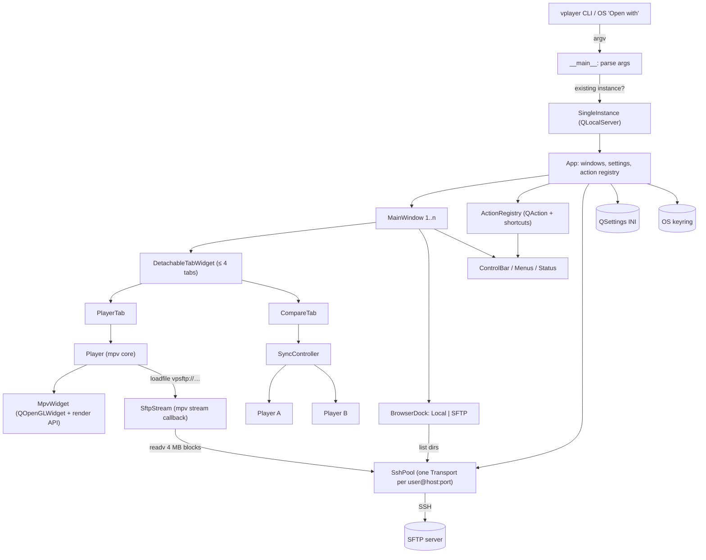
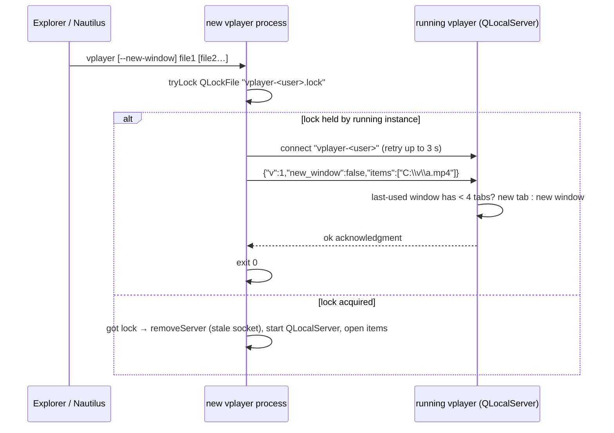
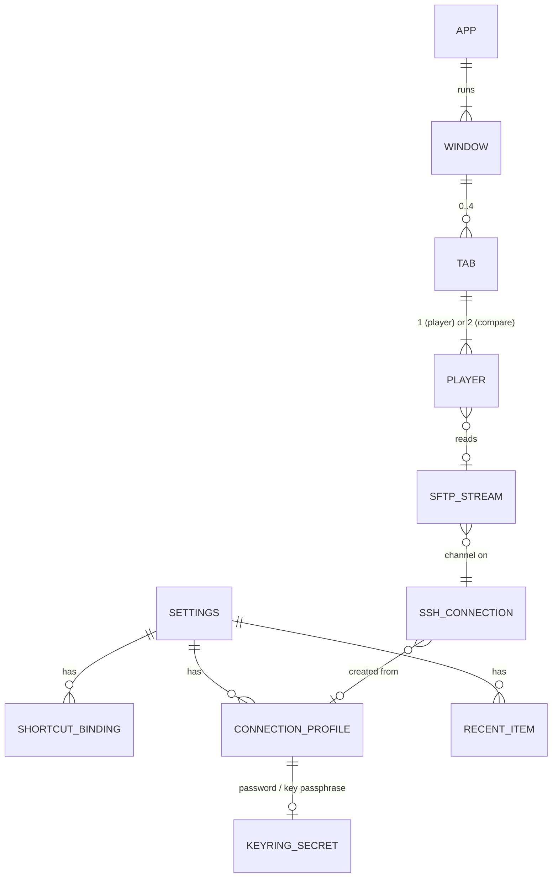

# Technical Design: VPlayer — Desktop Video Player (local + SFTP, frame-accurate)
**Date**: 2026-10-11 | **Status**: Final (15 alternating GPT-6 Sol / Claude Opus review rounds; remaining unknowns tracked in §13 spikes) | **Requirements**: [Discovery (Approved)](2026-10-11_video-player_discovery.md)

## 1. Overview
VPlayer (app name approved 2026-10-11, may change later; binary `vplayer`) is a Python desktop app: a thin Qt shell around libmpv,
which does all demuxing, decoding, rendering, buffering and screenshots. The app adds what mpv
lacks: a local + SFTP file browser, SFTP streaming that never touches disk, tabs and multiple
windows, synced compare, one action registry giving every action both a UI control and a
rebindable shortcut, and OS integration for Windows 10/11 and Ubuntu 22.04.

**Design goals**: (1) keep heavy work in native code — no media bytes looped over in Python;
(2) all media buffering in mpv's RAM demuxer cache, bounded (FR-006/007); (3) the app never
crashes — every failure path ends in a message, not an exception (NFR-004/005); (4) fewest
moving parts — reuse mpv/Qt features before writing code.

**Constraints** (from discovery): personal use, GPL OK (NFR-014); Python first, Rust only if a
requirement can't be met (§12 AD-018); Windows 10/11 + Ubuntu 22.04 x64 (NFR-012); unsigned
Windows installer; AppImage on Linux. Multiple tabs per window (FR-035) and multiple windows
(FR-036), each tab with its own `Player` and independent state.

## 2. Tech Stack Selection
| Layer | Choice | Why (vs alternatives) | Docs |
|-------|--------|-----------------------|------|
| Language | Python 3.12 | Owner decision. 3.12 = newest version supported by all deps with mature PyInstaller support; PySide6 6.12 needs ≥ 3.10. | [python.org](https://docs.python.org/3.12/) |
| GUI | PySide6 (Qt 6), pinned to one tested 6.x minor that still lists Windows 10 as supported | Official Qt binding, LGPL. Gives `QFileSystemModel`, `QAction`, `QKeySequenceEdit`, `QOpenGLWidget`, `QLocalServer`, `QSettings` — most of the UI with no extra deps. PyQt6 rejected: same API, GPL/commercial, not official. | [PySide6](https://doc.qt.io/qtforpython-6/) |
| Media engine | libmpv via [python-mpv](https://github.com/jaseg/python-mpv) 1.0.8 (pinned; its `loadfile` handles mpv ≥ 0.38's extra `index` argument, needed with the current Windows libmpv) | Native `frame-step`, `frame-back-step`, exact `speed`, `screenshot-to-file … video`, `hwdec`, RAM demuxer cache with back-buffer, stream callback API, OpenGL render API. libvlc rejected: no backward frame step. QtMultimedia rejected: no frame stepping or custom stream with seek. python-mpv needs libmpv ≥ 0.33 → Ubuntu 22.04's 0.34.1 works. | [mpv manual](https://mpv.io/manual/stable/), [client.h](https://github.com/mpv-player/mpv/blob/master/include/mpv/client.h), [stream_cb.h](https://github.com/mpv-player/mpv/blob/master/include/mpv/stream_cb.h) |
| libmpv binaries | Windows: [shinchiro mpv-winbuild](https://github.com/shinchiro/mpv-winbuild-cmake/releases) `libmpv-2.dll` (pinned SHA-256). Linux: Ubuntu 22.04 `libmpv1` (0.34.1) bundled in AppImage | Prebuilt, includes FFmpeg with H.264/HEVC/VP9/AV1(dav1d)/AAC/MP3/Opus/AC-3 (FR-017). Building mpv ourselves rejected: hours of toolchain work for nothing we need. | [mpv.io/installation](https://mpv.io/installation/) |
| SSH/SFTP | [Paramiko](https://www.paramiko.org/) 5.x | Mature; key/agent/password auth incl. Windows OpenSSH agent; `known_hosts`; `SFTPFile.readv` pipelines many 32 KB requests at once. AsyncSSH rejected: asyncio loop next to Qt and mpv threads adds complexity for no gain. FFmpeg's built-in `sftp://` rejected: depends on how libmpv was built, no host-key confirmation UI. | [Paramiko SFTP](https://docs.paramiko.org/en/stable/api/sftp.html) |
| Secrets | [keyring](https://pypi.org/project/keyring/) | Windows Credential Manager / Secret Service (GNOME Keyring on Ubuntu) with one API (NFR-010). Own encrypted file rejected: key management problem. | [keyring docs](https://keyring.readthedocs.io/) |
| Settings | `QSettings` (INI format) | Built into Qt, per-user path per OS. JSON/SQLite rejected: more code, nothing relational to store. | [QSettings](https://doc.qt.io/qt-6/qsettings.html) |
| Single instance / IPC | `QLocalServer` / `QLocalSocket` | Built into Qt; named pipe on Windows, Unix socket on Linux. DBus rejected: Linux only. | [QLocalServer](https://doc.qt.io/qt-6/qlocalserver.html) |
| Packaging (bundle) | [PyInstaller](https://pyinstaller.org/) 6, one-folder mode | Best-supported freezer for PySide6. Nuitka rejected: much slower builds, no need for speedup (hot paths are native). One-file mode rejected: unpacks to temp on every launch (slow, disk writes). | [PyInstaller](https://pyinstaller.org/en/stable/) |
| Windows installer | [Inno Setup](https://jrsoftware.org/isinfo.php) 6 | Per-user install, HKCU PATH edit, registry for "Open with"/context menu, clean uninstall — all declarative. MSIX rejected: requires signing. WiX rejected: far more verbose. | [Inno Setup help](https://jrsoftware.org/ishelp/) |
| Linux package | [appimagetool](https://github.com/AppImage/appimagetool) + `install.sh` | Owner decision. Script installs AppImage to `~/.local/bin`, writes `.desktop`, icon, MIME. | [AppImage docs](https://docs.appimage.org/) |
| Tests | [pytest](https://docs.pytest.org/) + [pytest-qt](https://pytest-qt.readthedocs.io/) | Standard; pytest-qt drives Qt events. | — |
| Lint/format | [ruff](https://docs.astral.sh/ruff/) | One tool for lint + format. | — |
| Test media | [FFmpeg CLI](https://ffmpeg.org/ffmpeg.html) (dev only) | Generates frame-numbered clips in every codec under test; not shipped. | — |

**Dependency cost**: runtime deps = PySide6 (~250 MB installed, ~70 MB after PyInstaller
trimming), python-mpv (1 file), Paramiko (+ cryptography, bcrypt, PyNaCl), keyring. libmpv itself
is ~30–40 MB. Nothing else.

## 3. System Architecture


**Responsibilities and boundaries**
- **`Player`** — owns one `mpv.MPV` instance. Translates app commands (step, skip, speed,
  snapshot, …) into mpv commands; turns observed mpv properties (`time-pos`, `pause`, `speed`,
  `estimated-vf-fps`, `container-fps`, `demuxer-cache-state`, `eof-reached`) into Qt
  signals. mpv is the single source of truth for playback state. No Qt widget code.
- **`MpvWidget`** — `QOpenGLWidget` that renders a `Player` through the mpv OpenGL render API
  (`vo=libmpv`). Qt owns the window and all input; mpv only draws into Qt's framebuffer (AD-002).
- **`SftpStream`** — mpv custom stream for the `vpsftp://` scheme. Reads remote files in
  pipelined 4 MB blocks, copies into mpv's buffer with `ctypes.memmove`, reconnects transparently
  on drops (AD-003…AD-007). Its live copies count toward the FR-007 read-ahead budget: at most
  two 4 MiB copies of one block (Paramiko's `readv` chunks plus the assembled result) and no
  other buffers, so `demuxer-max-bytes` = `readahead_mb` − 10 MiB (2 × 4 MiB + 2 MiB headroom
  for mpv overshoot).
- **`SshPool`** — one authenticated `paramiko.Transport` per `user@host:port`, shared by the
  browser and all streams; one SFTP channel per open file. Holds credentials in memory for the
  session (needed to reconnect).
- **`ActionRegistry`** — single table of every action → `QAction` with id, label, icon, default
  shortcut, handler. Menus, toolbar, tooltips and Preferences → Shortcuts are all generated from
  it (FR-022/023/024). Actions act on the active tab of the focused window (FR-037).
- **`SyncController`** — drives two `Player`s in a `CompareTab` (FR-044–049).
- **`SingleInstance`** — the process holding a per-user `QLockFile` is primary and listens on a
  user-scoped local socket; later launches forward their args and exit (FR-042/043, §4.5).
- **Error surfacing** (FR-026) — mpv skips corrupt packets by itself. A file that can't be
  played (`end-file` with error, missing file, unsupported format) shows a non-blocking banner in
  its tab with the reason; the tab stays open and the app keeps running.

**Initially deferred from v1** (per discovery): FR-032 resume position and FR-034 other
protocols (Won't). FR-033 A-B loop (Could) was implemented early in v0.30.0.

**mpv configuration** (applied to every `Player`; fixed, not user-editable unless noted):

| Option | Value | Why |
|--------|-------|-----|
| `vo` | `libmpv` | Render API into Qt widget (AD-002) |
| `hwdec` | `auto-safe` (setting; fallback `no`) | FR-016; mpv falls back to software per file automatically |
| `config`, `load-scripts`, `ytdl` | `no` | Ignore user's mpv.conf/Lua scripts; never shell out to yt-dlp (security, reproducibility) |
| `input-default-bindings`, `input-vo-keyboard`, `osc` | `no` | All input via ActionRegistry |
| `keep-open` | `yes` | Stay on last frame at EOF so frame-back-step still works |
| `hr-seek` | `default` | Exact only where the app asks: frame steps and ±n skips pass `exact`. Seek bar (drag and release) and ±5 s / ±60 s time seeks pass `keyframes`, so they show a frame fast (NFR-007); frame-precise positioning is what frame steps are for. `frame-back-step` is always exact in mpv |
| `cache` | `yes` | Enables demuxer cache for custom streams too |
| `cache-on-disk` | `no` | FR-006 — RAM only |
| `demuxer-max-bytes` | local 64 MiB / SFTP = `readahead_mb` − 10 MiB (default 54 MiB) | FR-007 read-ahead; 8 MiB for the SFTP block copies + 2 MiB headroom for mpv overshoot |
| `demuxer-max-back-bytes` | local 32 MiB / SFTP = max(0, `backbuffer_mb` − 1) MiB (default 255) | FR-007 back-buffer for back-step/seek back; 1 MiB headroom for overshoot |
| `demuxer-donate-buffer` | `no` | Otherwise mpv lends unused read-ahead space to the back-buffer, so the back-buffer could exceed its own cap (FR-007). mpv may overshoot each limit by about one packet, which the headroom above absorbs; the peak-buffer test (§10) verifies it |
| `audio-pitch-correction` | setting (default `yes`) | FR-010 |
| `screenshot-jpeg-quality` | setting `jpeg_quality` | FR-019. Format comes from the file extension (`.png`/`.jpg`) — `screenshot-to-file` ignores `screenshot-format` |
| `screenshot-high-bit-depth` | `no` | 8-bit PNG viewable everywhere |

## 4. Key Workflows

### 4.1 Connect and stream a remote file (FR-003/004/005/006)
```mermaid
sequenceDiagram
    actor U as User
    participant D as ConnectDialog
    participant Pool as SshPool (worker thread)
    participant HK as HostKeyDialog (UI thread)
    participant P as Player (mpv)
    participant S as SftpStream (mpv demux thread)
    participant R as SFTP server
    U->>D: host, port, user, auth
    D->>Pool: connect(profile)
    Pool->>R: SSH handshake
    R-->>Pool: host key
    alt key unknown or changed
        Pool->>HK: confirm(fingerprint SHA256)
        HK-->>Pool: accept / reject
    end
    Pool->>R: authenticate (profile's method; ad-hoc: agent → key → password)
    U->>P: open /data/rec.mkv
    P->>P: loadfile vpsftp://u@h:22/data/rec.mkv
    P->>S: open(uri) → open SFTP channel + file, stat size
    loop mpv demuxer fills RAM cache (≤ read-ahead)
        P->>S: read(n) / seek(pos)
        S->>R: readv(128 tuples of ≤ 32 KiB covering the 4 MiB block, ≤ 64 in flight) on cache miss; b"".join the results
        R-->>S: 4 MB block
        S-->>P: memmove into mpv buffer
    end
```
Connecting (including host-key prompt) happens **before** `loadfile`, on a worker thread with the
prompt marshalled to the UI thread. `SftpStream.open` only uses an already-trusted, authenticated
transport, so mpv's demux thread never waits on the user. CLI/`Open with` `sftp://` URIs go
through the same connect step (reusing a saved profile when one matches).

**Host-key check (FR-004)**: `SshPool` uses `paramiko.Transport` directly, not `SSHClient`.
After `start_client()`, it compares `get_remote_server_key()` with the entries from
`~/.ssh/known_hosts` and the app's file (matching rules in §5.2; entries for ports other than 22 are keyed
`[host]:port`). Before `start_client()`, key types already known for that host are put first in
`get_security_options().key_types`, so the server offers a key we can check. No entries for
that host and port → HostKeyDialog (unknown). Any entry exists but none matches the presented
key — same type or a different type — → HostKeyDialog with red "changed key" warning.
Authentication starts only after the key is accepted.

**Timeouts**: TCP connect 10 s; SSH banner and auth 15 s; each SFTP channel `settimeout(15)`,
so a silently dead link raises `socket.timeout` instead of blocking forever; SSH keepalive every
`keepalive_s` (15 s).

**`~/.ssh/config` aliases (FR-051)**: the host field accepts an alias. `paramiko.SSHConfig`
looks it up and fills `HostName`, `Port`, `User`, `IdentityFile`; values typed in the dialog win.
Every other directive in the matched result (e.g. `ProxyJump`, `HostKeyAlias`, `IdentityAgent`)
is ignored and listed by name in a non-blocking notice: "Ignored SSH config settings: …". Host
keys are checked against the resolved hostname and port. A missing config file is ignored.
`Match exec` would run a shell command during lookup (Paramiko 5 depends on `invoke`), so the
app reads the file text, drops every `Match` block whose criteria include `exec` (from that
`Match` line up to the next `Host`/`Match` line), and parses the rest with
`SSHConfig.from_text`. It also drops `CanonicalizeHostname`, `CanonicalDomains` and other
`Canonical*` lines, because Paramiko applies them during `lookup()` (DNS lookups, changed
host). Other `Host` aliases keep working; if any block or line was dropped, the
notice lists "Match exec blocks skipped" / the dropped directive names. Any
exception while parsing or looking up → config ignored with notice "Couldn't read
~/.ssh/config: <reason>". The same lookup applies to `sftp://alias/path` from the CLI.

### 4.2 Network drop during playback (FR-025, NFR-005)
```mermaid
sequenceDiagram
    participant P as Player (mpv)
    participant S as SftpStream
    participant Pool as SshPool
    participant UI as Tab UI
    P->>S: read(n)
    S--xS: socket error / EOFError / SSHException
    S->>UI: signal reconnecting(attempt)
    Note over P: mpv cache runs dry → auto-pauses (cache-pause)
    loop backoff 1, 2, 4, 8, 16 s, then 30 s for each further attempt (retry_max attempts, default 6; 0 = fail at once)
        S->>Pool: reconnect(same host key, cached creds)
        alt success
            S->>S: reopen file, seek to last offset
            S-->>P: data (playback resumes by itself)
            S->>UI: signal reconnected
        end
    end
    alt attempts exhausted or stream cancelled
        S->>P: connection_failed() (exhausted only, before read returns)
        S-->>P: read returns -1 (mpv 0.34 treats it as EOF, so end-file reason is not relied on)
        P->>UI: connection_failed(last time-pos) → "Connection lost at 01:23:45.678" + Retry (normal EOF never shows Retry)
        UI->>P: Retry → reconnect, loadfile … start=<last pos>
    end
```
Reconnect happens **inside** `read()`; mpv just sees a slow read, pauses when its cache runs
dry (`cache-pause`, satisfying FR-025's "pause"), and resumes once data flows. A backoff delay
precedes every attempt, including the first, so with defaults the last attempt starts ≥ 61 s
after the drop is detected even when attempts fail instantly (and detection itself can take up
to the 15 s read timeout); the default settings therefore tolerate any outage ≤ 60 s (NFR-005's
1–60 s drops). When retries are exhausted, `SftpStream` emits `connection_failed()` and then
returns -1; the owning `Player` adds its last observed `time-pos` and re-emits
`connection_failed(float last_position_s)`, which both the banner time and Retry's `start=`
use. No reload, no lost
position, no player-level logic (AD-007). A changed host key on reconnect is a hard failure (never
silently accepted). `cancel()` (called by mpv on stop/close) sets a flag and closes the stream's
SFTP channel, so a blocked read ends at once. Reconnect attempts run on the `SshPool` worker;
the stream waits on a `threading.Event` and checks the cancel flag at least every 100 ms, so on
cancel `read()` returns -1 at once and an in-progress connect finishes or fails in the
background. `Player.close()` runs mpv's `terminate()` off the GUI thread.

**Shared connection**: several streams (and the browser) can share one `SshConnection`.
Reconnect is serialized per connection with a lock and a generation counter: the first failing
stream rebuilds the transport; streams that were waiting see the newer generation and reuse it.
Each stream then reopens its own file and seeks to its own offset.

### 4.3 Frame step and n-frame skip, single and compare (FR-011–013, FR-045)
```mermaid
sequenceDiagram
    actor U as User
    participant AR as ActionRegistry
    participant SC as SyncController
    participant A as Player A
    participant B as Player B
    U->>AR: "." (next frame)
    AR->>SC: frame_step(+1)
    par
        SC->>A: frame-step
        SC->>B: frame-step
    end
    A-->>SC: time-pos changed
    B-->>SC: time-pos changed
    SC->>SC: check |posA − offset − posB| ≤ ½ frame, else exact seek B
    U->>AR: "Ctrl+." (skip +n)
    AR->>SC: skip(+n)
    par
        SC->>A: seek (k+n)/fps absolute+exact
        SC->>B: seek (k+n)/fps − offset absolute+exact
    end
    Note over SC,B: Sync on: A is master; B gets no movement command while its target is outside B (held at its end, §4.4 Out of range). If either side has the VFR mark (§4.4), A skips as a single tab would and, once done, B exact-seeks to posA − offset (clamped). Sync off: step/skip go only to the active side (A or B)
```
- **fps used everywhere** (frame numbers, ±n skip, FR-048 check, VFR heuristic) = `container-fps`
  if > 0, else `estimated-vf-fps` once available. If neither: frame number shows `f —`, ±n skip
  falls back to n single `frame-step` / `frame-back-step` calls while paused (FR-013 still
  works, just slower), the frame part of `copy_position` is omitted, and compare is refused
  with "Frame rate unknown".
- **Single-step fallback** (used for ±n when fps is unknown or the VFR mark of §4.4 is set):
  a queued sequence — send one step, wait for it to finish (`playback-restart` for
  `frame-back-step`; the next `time-pos` change with `pause=yes` for `frame-step`), then send
  the next (mpv 0.34 ignores or merges back-steps sent while one is still running). The status
  bar shows "Skipping i/n". The queue ends early, showing "Skipped i/n" (i = steps that moved
  `time-pos`), when a step completes without changing `time-pos` (no earlier/later frame),
  when `eof-reached` turns true after a forward step, or when a single step does not finish
  within 2 s. Any other playback command,
  including another skip, cancels the remaining steps; the video stays on the frame reached so
  far.
- **Frame number** shown, copied (`copy_position`), used in snapshot names and used as *k* is
  one formula everywhere: round(`time-pos` × fps). When fps is unknown, snapshot names omit
  `_f<frame>`.
- **±1 frame**: if playing, the Player first sets `pause=yes`, then sends `frame-step` (mpv's
  `frame-step` on its own plays one frame and then pauses; FR-011 wants pause first).
  `frame-back-step` pauses by itself and decodes from the previous keyframe using the demuxer
  back-buffer.
- **±n frames**: pause, read current frame index *k* = round(`time-pos` × fps), then one exact
  absolute seek to `max(0, k ± n) / fps` (only while the VFR mark of §4.4 is not set;
  otherwise the single-step fallback above is used) (never negative — mpv reads a negative absolute seek
  as "from the end"; a target past the end lands on the last frame because `keep-open=yes`) —
  one decode run instead of n displayed steps. Valid for CFR
  content (NFR-008 is CFR-only). The frame-accuracy test (§10) checks the displayed frame against
  an index burned into the test clips, not against mpv's own estimate.
- **Single tab**: same calls, on one `Player`.

### 4.4 Synced compare (FR-044–049)
- **Entering compare** (never uses an extra tab, so FR-040's limit can't be exceeded;
  `compare_with` / `compare_tabs` are disabled when the active tab is already a compare tab, and
  the `compare_tabs` picker lists only single-player tabs):
  - "Compare with…" picks a second file (local or SFTP). It loads paused into a new `Player`;
    the active tab (A) is untouched until the check passes.
  - "Compare tabs" picks another open tab. The check uses that tab's fps; a suspended tab
    (§4.7) uses the fps saved in its suspend record, so nothing is reloaded unless the check
    passes. If it passes, a suspended tab is first resumed paused at its saved position; then
    that tab's `Player` moves into the active tab (no reload; render context freed and
    recreated as in §4.6) and the other tab closes.
  - **Transition** (both paths, after the check passes): remember whether A was playing, pause
    both, set B.speed = A.speed, offset = 0, exact-seek B to A's position (clamped, see
    Offset), show the compare tab; if A was playing, resume A, and resume B only if
    posA − offset is inside B's range (otherwise B stays paused under Out of range).
  - **Check**: both fps values (see §4.3) must satisfy `abs(a − b) < 0.001`,
    so 29.97 vs 30000/1001 match but 29.97 vs 30 don't. On mismatch: error dialog showing both
    rates; nothing changes — the new `Player` is discarded, or both tabs stay as they were
    (FR-048).
  - VFR heuristic (FR-014): checked once per loaded file, after at least 1 s of media time has
    been decoded since load (by playback or steps) and `estimated-vf-fps` is available: if it
    differs from `container-fps` by more than 1%, the file gets the VFR mark for the rest of
    that load (never cleared; a reload, e.g. resume from suspend, re-checks). Until the check
    has run, ±n uses the nominal-rate seek. With the mark set,
    frame numbers show as "≈ f 22213", ±n skip on that file switches to the single-step
    fallback of §4.3 (exact regardless of fps), and a compare tab shows
    "Variable frame rate: frame alignment approximate". The same check catches CFR files whose
    `container-fps` metadata is wrong by more than 1% (mpv documents it as possibly
    inaccurate). It is a best-effort detector, not proof of CFR: a file that turns VFR later,
    or a nominal rate off by < 1%, still uses the nominal-rate seek, consistent with the
    discovery §9 assumption that frame-exact ±n (FR-013, NFR-008) targets CFR files with
    correct metadata. The FR-048 admission check runs before playback and
    uses the nominal rate; a wrong nominal rate there is surfaced by this banner after the tab
    opens. Frame-exact compare (NFR-008) is guaranteed for CFR only (discovery §9 assumption).
- **Leaving compare**: closing the compare tab closes both players.
- **Active side**: A when the compare tab opens; changed by clicking a pane or with
  `compare_switch_side` (Ctrl+;). The active pane has a visible focus border. Snapshot,
  `copy_position`, `cycle_audio`, `cycle_sub`, `load_sub` and (with sync off) playback commands
  act on the active side. `volume_*` and `mute` act on the side that has audio (the unmuted
  one; A if both are muted). The seek bar and time/frame label show A while sync is on and the
  active side while it's off.
- **Offset** = how many seconds later B's recording started than A's (discovery scenario: B
  started 2.4 s later → offset 2.4). B's target position = A's position − offset. Set by a spin
  box in seconds with ±1 frame buttons (FR-046); always rounded to whole frames
  (`round(offset × fps) / fps`). Editing the offset (sync on) pauses both, exact-seeks B to the
  new mapped position, then resumes if they were playing (subject to Out of range). "Sync"
  toggle: off = playback commands (play/pause, seek, step, skip, speed) go only to the active
  side and the offset spin box is disabled; "Snapshot both" and "Swap audio" still act on both
  sides. Turning sync back on pauses both, sets offset = posA − posB (rounded; spin box
  updates), so adjustments made while unsynced are kept, sets B.speed = A.speed, applies Out
  of range, and leaves both paused; Play then resumes both.
  **Out of range**: for every synced command, B's unclamped target (posA − offset) is computed
  first. If it is outside [0, B's duration], B is seeked to that end (never a negative
  absolute seek, which mpv treats as "from the end") and kept paused — play, seek, step and
  skip don't move it — and its pane shows "B not started yet" / "B ended". The 250 ms tick
  watches the mapped position; when A re-enters B's range, B exact-seeks to the mapped
  position, then resumes if A is playing.
- **Seeking** (seek bar, ±5 s / ±60 s): A seeks with `keyframes` as usual; after A's
  `playback-restart`, B exact-seeks to posA − offset (clamped). If playing, both stay paused
  until B's `playback-restart`, then resume. NFR-007 timing applies to A.
- **Playing**: user commands go to both players. Every 250 ms during playback the controller
  reads both `time-pos` values in the same tick. If |posA − offset − posB| > max(2 frames,
  100 ms) on 2 checks in a row, it pauses both, exact-seeks B to posA − offset, waits for B's
  `playback-restart` event, then unpauses both. At most one correction per 2 s (AD-014).
- The drift corrector and the post-step alignment check (§4.3) run only while sync is on and
  A's mapped position is inside B's file.
- **A at EOF** (sync on): when A's `eof-reached` turns true, the controller pauses B too. Play
  does nothing until A is moved back from its end.
- **Audio**: entering compare keeps A's own mute and volume; B starts muted. "Swap audio" swaps
  the two sides' mute states.
- **Snapshot**: active side by default; "Snapshot both" writes two PNGs (always PNG, per FR-047)
  named with `_A` / `_B` before the extension.
- **Buffer health**: per-side bar from `demuxer-cache-state` when the source is SFTP (FR-049).

### 4.5 Open with / CLI routing (FR-002, FR-042/043)

The lock file (in the user's temp dir) guarantees one primary even when two launches race —
Windows lets two `QLocalServer`s listen on one name, so the socket alone isn't enough. A stale
lock from a crashed process is taken over by `QLockFile` after its owner PID is gone.
"Last-used window" = the window that most recently had focus. Opening from inside the app
(menu, browser, drag-and-drop) into a window that already has 4 tabs shows a message: "This
window has 4 tabs. Close one, or open in a new window" with an **Open in new window** button
(FR-040).

### 4.6 Moving a tab between windows (FR-041)
Two routes, one code path: drag a tab onto another window's tab bar, or action
`move_tab_new_window` (Ctrl+Shift+N; also in the tab's context menu), which moves the current
tab into a new window (keyboard route, NFR-011). A window's only tab can be moved too; the
emptied source window then follows the 0-tabs rule below.
The `Player` (mpv core, cache, SFTP stream) stays alive; the target reparents the
`PlayerTab`. Set `Qt.AA_ShareOpenGLContexts` **before** constructing `QApplication`:
Qt then keeps the widget's GL context on cross-window reparent, so the mpv render
context and video track stay live without any re-enable call or media reload.
`MpvWidget.release()` still frees the render context on actual context destruction
and on close. Without shared contexts, freeing an active mpv render context
disables video; an audio/video file can recover by reselecting `vid` and seeking
to its saved position, but a video-only file loses its loaded state (§13).

No reload, no re-buffering. Dropping outside any window creates a new window. Dropping onto a
window that already has 4 tabs is refused ("not allowed" cursor; the tab stays where it was). A
window left with 0 tabs after a move (drag or `move_tab_new_window`) closes, unless it's the
only window, which keeps its 0-tab placeholder (§6). On tab/window
close, `PlayerTab.close()` frees the render context explicitly (same `makeCurrent` sequence)
before the widget is deleted (PySide may not deliver signals during destruction), then closes
the `Player`.

### 4.7 Background tabs (FR-039, NFR-001)
"Hidden" = not the current tab in its window, or its window is minimized. A window that's merely
behind another window counts as visible.
- **Default "pause"**: when a tab is hidden, record `was_playing_before_hide`, then pause it.
  After 60 s hidden, **suspend**: record
  `(uri, time-pos, fps, speed, volume, mute, selected aid/sid, external subtitle paths,
  was_playing_before_hide, and for compare tabs offset, sync on/off and active side)`, run mpv
  `stop` on each of the tab's players (frees decoder and demux
  cache — releases up to 320 MB for SFTP), keep the `Player` object. On show: `loadfile …
  start=<pos>`, paused; after `file-loaded`, re-add external subtitles with `sub-add` (each
  awaited), then restore the selected aid/sid and the rest of the state. A suspended tab stays under 60 MB (NFR-001). During its first 60 s
  hidden, a tab keeps its buffers so quick tab switches don't reload.
- **On show**: a tab with `was_playing_before_hide` resumes playing (a suspended tab only after
  its reload and track/subtitle restore finish); a tab the user had paused stays paused.
  Resuming a suspended SFTP tab (and Retry, §4.2) first calls
  `SshPool.connect(profile)` on the worker thread — cached credentials, no prompt; a changed
  host key is an error — then `loadfile`.
- **Wayland limitation**: Qt isn't told when a window is minimized on Wayland, so there only
  non-current tabs count as hidden (discovery FR-039 note).
- **"Keep playing, muted"**: hidden tabs keep playing with audio muted; on show, each tab gets
  back its own pre-hide mute state (volume and playback untouched). No suspending.
- **"Keep playing with audio"**: no pausing, muting or suspending.
- Both keep-playing modes accept the memory and decoder cost (§13).

## 5. Data Model
No database. Persistent data = settings + secrets; everything else is runtime state.

### 5.1 High-Level (entities & relationships)

Persisted: `SETTINGS`, `SHORTCUT_BINDING`, `CONNECTION_PROFILE`, `RECENT_ITEM` (QSettings);
`KEYRING_SECRET` (OS keyring); app `known_hosts` file. Runtime only: `APP`, `WINDOW`, `TAB`,
`PLAYER`, `SFTP_STREAM`, `SSH_CONNECTION`.

### 5.2 Low-Level Schema
QSettings INI keys (file: Windows `%APPDATA%\vplayer\vplayer.ini`, Linux
`~/.config/vplayer/vplayer.ini`). "Index" column = lookup key.

| Group | Key | Type | Null | Index | Notes |
|-------|-----|------|------|-------|-------|
| — | `schema_version` | int | no | — | Starts at 1 (§5.3) |
| playback | `speed_step` | float | no | — | Default 0.05; range 0.01–1.0 |
| playback | `skip_frames` | int | no | — | n for ±n skip (FR-013); default 10; 2–1000 |
| playback | `seek_short_s` / `seek_long_s` | int | no | — | Defaults 5 / 60 (FR-015); ranges 1–600 / 1–3600 |
| playback | `background_tabs` | enum `pause`/`muted`/`play` | no | — | Default `pause` (FR-039) |
| playback | `pitch_correction` | bool | no | — | Default true (FR-010) |
| playback | `hwdec` | enum `auto-safe`/`no` | no | — | Default `auto-safe` |
| playback | `overlay` | bool | no | — | Frame/timecode overlay on/off |
| resume | `enabled` | bool | no | — | Default false; opt in to resuming local files (FR-032) |
| resume/positions | `<sha256 of normalized absolute path>` | float seconds | yes | file path hash | Store on close or replacement; no plaintext local paths or SFTP positions |
| snapshot | `dir` | path | no | — | Default `<Pictures>/vplayer` |
| snapshot | `format` | enum `png`/`jpg` | no | — | Default `png`; decides the file extension, which sets mpv's output format |
| snapshot | `jpeg_quality` | int | no | — | Default 90; 50–100 |
| network | `readahead_mb` | int | no | — | Default 64; 16–64 (FR-007; includes the two 4 MiB SFTP block copies and 2 MiB headroom, §3) |
| network | `backbuffer_mb` | int | no | — | Default 256; 0–256 (owner cap; includes 1 MiB headroom, §3) |
| network | `retry_max` | int | no | — | Default 6; 0–20 |
| network | `keepalive_s` | int | no | — | Default 15; 5–300; SSH keepalive |
| shortcuts | `<action_id>` | string (`QKeySequence.PortableText`) | yes | action_id | Missing = default. Never empty: every action keeps one shortcut (FR-022), so the editor has no "clear" — only rebind. On conflict the editor warns and offers **Swap** (other action takes the old key) or **Cancel**; never two actions on one key. An invalid or empty stored value falls back to the default. "Reset" per action and "Reset all" delete keys (FR-023) |
| connections | `<uuid>/name` | string | no | uuid | Display name |
| connections | `<uuid>/host`, `/port`, `/user` | string, int, string | no | (host,port,user) unique | Port default 22 |
| connections | `<uuid>/auth` | enum `agent`/`key`/`password` | no | — | |
| connections | `<uuid>/key_path` | path | yes | — | Only for `key` |
| connections | `<uuid>/save_secret` | bool | no | — | If true, secret in keyring |
| recent | `items` | list[string] | no | — | Max 20, newest first; local paths or `sftp://user@host:port/path` (never secrets) |
| window | `geometry`, `state` | bytes | yes | — | Last window layout |

**Keyring**: service `vplayer`, username `<profile uuid>/<auth>` (`password` or `key`) → the
password or key passphrase. If `keyring` has no usable backend (Credential Manager / Secret
Service), the "save secret" checkbox is disabled with a tooltip; the secret is kept in memory for
the session only.
**Known hosts**: read `~/.ssh/known_hosts` (read-only) + app file `<config dir>/known_hosts`,
each into its own `paramiko.HostKeys` object. A host is trusted if the presented key equals
**any** entry for its lookup name (`host`, or `[host]:port` when the port isn't 22, hashed
`|1|` names included) in **either** file. `HostKeys.check()` / `lookup()[type]` aren't used
for this, because they return only the first key of each type; the app walks all matching
entries instead. Newly accepted keys are `add()`ed + `save()`d on the app-file object only
(AD-013).

### 5.3 Migrations & Versioning
`settings.load()` reads `schema_version`; when it's lower than the app's version it runs
`MIGRATIONS[v]` functions in order, then writes the new version. Unknown/invalid values →
default plus a warning in the log (never a crash). Settings from a newer app version are read
as-is and missing keys use defaults.

## 6. API Design
No network API. The contracts are the CLI, the IPC message, the custom mpv stream scheme and the
action IDs.

**CLI** (`vplayer`)
| Form | Behaviour | Errors |
|------|-----------|--------|
| `vplayer` | Open a window with 0 tabs (placeholder, §6 Tabs and files), or focus running instance | — |
| `vplayer FILE…` | Open each as a tab in last-used window; overflow beyond 4 tabs → new window | Missing file → error toast, others still open |
| `vplayer sftp://[user@]host[:port]/path …` | Connect (saved profile if matching, else ConnectDialog prefilled), then open | Auth/host-key failure → dialog; no crash |
| `vplayer --new-window FILE…` | Open in a new window (FR-043) | — |
| `vplayer --version` | Print version | — |
Exit code 0 when forwarded to a running instance.

**IPC** (`QLocalSocket`, name `vplayer-<username>`): one UTF-8 JSON message, max 64 KB,
`{"v":1,"new_window":bool,"items":[str]}`. Receiver checks size, version, types; items must be
absolute local paths or `sftp://` URIs. Anything else is dropped and logged. Before forwarding,
the sender makes every local argument absolute (`os.path.abspath` against its own working
directory); `sftp://` URIs pass unchanged. The primary does the same for its own argv. On
Windows the sender calls `AllowSetForegroundWindow(ASFW_ANY)` first, so the receiver's
`raise_()` + `activateWindow()` can bring the target window to the front. The
sender exits successfully only after the server acknowledges an accepted request.

**Stream scheme**: `vpsftp://<user>@<host>:<port>/<url-encoded path>` — internal only, never shown
to the user. Separate from `sftp://` so FFmpeg's own sftp handler is never used.

**Player facade** (Python, used by actions and SyncController): `load(uri, start=0, paused=False)`
(sets `demuxer-max-bytes`/`demuxer-max-back-bytes` for the source type — local or SFTP, §3 —
right before each `loadfile`, including resume after suspend),
`play_pause()`, `frame_step(+1|-1)`, `skip_frames(n)`, `seek(seconds, relative)`,
`set_speed(x)` / `nudge_speed(±step)` (both clamp to 0.05–8.0x, FR-009), `snapshot(path=None) -> Path`,
`set_volume`, `toggle_mute`, `cycle_audio`, `cycle_sub`, `add_sub(path)`, `suspend()`, `resume()`,
`close()`, `state() -> dict`.

`snapshot(None)` = quick-save to `snapshot/dir` as
`<source stem>_<HH-MM-SS.mmm>_f<frame>.<ext>` (FR-020). The name is reserved by creating an
empty file with exclusive create (`open(path, "x")`, atomic on both OSes); if it exists, try
`_2`, `_3`, … mpv's `screenshot-to-file` then writes into that reserved file, so an existing
file is never overwritten. On failure the empty file is deleted. A toast shows the saved path
with "Open folder" after mpv reports completion.

`close()` (tab/window close, app exit): on the Qt thread, free the render context (§4.6) and
cancel the stream (§4.2); then mpv `terminate()` on a worker thread — this destroys the core,
which calls the stream's `close` → SFTP channel closed. Same contract for tab, window and app
shutdown. The window also closes its owned transports on that worker; `wait_closed(timeout)`
joins it when callers need to await cleanup. An `SshConnection` closes 60 s after its last
channel/browser user is gone.
Signals: `position(float, int frame)`, `duration`, `paused`, `speed`, `fps`, `cache(float s)`,
`error(str)`, `reconnecting(int)`, `reconnected()`, `connection_failed(float last_position_s)`.

**Action IDs and default shortcuts** (FR-022/038; all rebindable). Covers speed presets
(FR-008), volume/mute/fullscreen (FR-021), audio/subtitle tracks (FR-027):

| Action id | Default | Action id | Default |
|-----------|---------|-----------|---------|
| `play_pause` | Space | `volume_up` / `volume_down` | Up / Down |
| `frame_next` / `frame_prev` | `.` / `,` | `mute` | M |
| `skip_n_fwd` / `skip_n_back` | Ctrl+. / Ctrl+, | `fullscreen` | F (Esc exits) |
| `seek_fwd` / `seek_back` | Right / Left | `snapshot` / `snapshot_as` | S / Ctrl+Shift+S |
| `seek_long_fwd` / `seek_long_back` | Shift+Right / Shift+Left | `snapshot_both` | Alt+S |
| `speed_up` / `speed_down` / `speed_reset` | ] / [ / Backspace | `open_file` / `connect_sftp` | Ctrl+O / Ctrl+Shift+O |
| `speed_0_25` … `speed_4_0` (6 presets) | Alt+1 … Alt+6 | `new_tab` / `close_tab` | Ctrl+T / Ctrl+W |
| `cycle_audio` / `cycle_sub` / `load_sub` | A / J / Ctrl+J | `next_tab` / `prev_tab` | Ctrl+Tab / Ctrl+Shift+Tab |
| `compare_with` / `compare_tabs` | Ctrl+K / Ctrl+Shift+K | `new_window` | Ctrl+N |
| `sync_toggle` / `swap_audio` | Ctrl+L / Ctrl+Shift+A | `offset_plus_frame` / `offset_minus_frame` | Alt+. / Alt+, |
| `toggle_overlay` | I | `toggle_browser` / `preferences` | Ctrl+B / Ctrl+P |
| `copy_position` | Ctrl+Shift+C | `toggle_debug_overlay` | Shift+I |
| `compare_switch_side` | Ctrl+; | `move_tab_new_window` | Ctrl+Shift+N |
| `open_file_new_window` | Ctrl+Alt+O | | |
| `ab_set_a` / `ab_set_b` / `ab_clear` | Ctrl+Alt+1 / Ctrl+Alt+2 / Ctrl+Alt+0 | | |

**Tabs and files**: a window with no file open has 0 tabs and shows an "Open file / Connect to
server" placeholder; no empty tab is ever created. `open_file` (Ctrl+O) opens a local file
picker and plays the chosen file in the active tab, replacing its video (in a 0-tab window it
creates the first tab). `new_tab` (Ctrl+T) opens the same picker and plays the chosen file in a
new tab, subject to the 4-tab rule (§4.5). `open_file_new_window` (Ctrl+Alt+O; File menu)
opens the same picker and plays the file in a new window; if the browser dock has keyboard
focus and a file (not a folder) is selected, it opens that file instead (same handler as the
browser's "Open in new window", FR-043). If the active tab is a compare tab, `open_file` replaces it with a single-player tab
for the chosen file (both compare players close); cancelling the picker changes nothing.
Closing the last tab leaves the placeholder; the
window stays open.
Each `PlayerTab` owns its player and render surface; closing detaches the player
from Qt's tab parent before asynchronous native shutdown, then schedules
deletion on the Qt thread. Window-level controls reflect the selected tab.
`AppController` owns the open-window list and Ctrl+N creates a window with
independent tabs. Closing one window tears down only its players; closing the
last requests app quit.
The controller remembers the last activated window for future external opens;
each window's playback shortcuts use its own selected tab.

`copy_position` (FR-050) copies `<HH:MM:SS.mmm> f<frame>` of the current tab, e.g.
`00:12:34.567 f22213`, or only `<HH:MM:SS.mmm>` when fps is unknown (§4.3); in compare view,
of the active side. A toast confirms.

## 7. Frontend & UI Design
### Route Map (windows & dialogs)
| Surface | Access | Purpose |
|---------|--------|---------|
| MainWindow | always | Tabs, controls, browser dock |
| ConnectDialog | `connect_sftp` | New/saved SFTP profile, host or `~/.ssh/config` alias (FR-051), auth choice, "save secret" checkbox |
| HostKeyDialog | on unknown/changed key | Shows SHA256 fingerprint, accept once / accept & remember / reject. Changed key → red warning, no "remember" default |
| PreferencesDialog | `preferences` | Pages: Playback, Snapshots, Network, Shortcuts |
| Snapshot Save As | `snapshot_as` | Native `QFileDialog`, PNG/JPEG filter |
| Compare picker | `compare_with` / `compare_tabs` | File picker (local/SFTP) or list of open tabs |

### Component Structure
```text
MainWindow (QMainWindow)
├── MenuBar                     ← generated from ActionRegistry; File → Open Recent (FR-028)
├── DetachableTabWidget         (QTabWidget + TabBar with drag-out)
│   ├── PlayerTab               → MpvWidget + OverlayLabel (frame/timecode, reconnecting)
│   └── CompareTab              → MpvWidget A | MpvWidget B (QSplitter) + offset/sync strip
├── ControlBar (QToolBar)       ← ActionRegistry buttons + speed QComboBox + volume QSlider
├── SeekBar (QSlider) + StatusLabel "00:12:34.567 · f 22213 / 01:40:00 · 1.00x · 29.97 fps" (FR-014, FR-015)
└── BrowserDock (QDockWidget, QTabWidget)
    ├── Local:  QTreeView + QFileSystemModel (name filter = media extensions with `setNameFilterDisables(False)` so other files are hidden, not greyed; "All files" toggle switches the filter to `*`) (FR-001)
    └── SFTP:   profile combo + QTreeView + SftpDirModel (lazy listdir on expand, worker thread)
```
**Browser actions** (both panes): double-click / Enter = open in new tab; context menu
**Open in new tab**, **Open in new window** (FR-043), **Compare with current tab**.
SFTP pane: permission-denied or vanished folders show an inline error row, never a dialog storm;
Paramiko decodes remote names strictly as UTF-8, so a folder containing a non-UTF-8 name shows
an inline error row "Can't list: filename not UTF-8" (v1 limitation). The local pane is
unaffected.
**State management**: playback state lives in mpv; widgets update from `Player` signals (no
duplicate state). Preferences in `QSettings`, read at startup and on change. The control bar is
bound to the **active tab** — on tab/window switch it reconnects to that tab's `Player`.

**Design system**: platform Qt style (Windows 11 / Fusion on Ubuntu), Qt standard icons plus a
few SVGs (frame step, skip, compare, snapshot). Video area black. No custom theming.

**Accessibility** (NFR-011): every control has `accessibleName` and a tooltip that includes the
current shortcut; logical tab order; visible focus (Qt default); everything reachable by keyboard
(fullscreen exits with Esc and the `fullscreen` shortcut); follows OS high-contrast palette; no
information shown by colour alone (buffer health also shows seconds as text).

**Keyboard focus vs single-key shortcuts** (NFR-011): while focus is in the browser dock, a
slider, a text field or a combo box, that widget accepts `ShortcutOverride` for navigation and
text keys (arrows, Space, Enter, Backspace, Home/End, PgUp/PgDn, printable keys), so those keys
go to the widget. Ctrl/Alt shortcuts still fire. Esc moves focus back to the video area. The
video area and tab bar never take the override.

**HiDPI**: Qt 6 handles scaling; `MpvWidget` passes framebuffer size in device pixels to mpv.

## 8. Security
- **Host keys** (FR-004, RFC 4251 §4.1): server key compared with both known-hosts files before
  authentication (§4.1) → HostKeyDialog. Changed key = explicit warning; reconnects never accept
  a new key.
- **Auth**: a saved profile uses only its `auth` method (avoids hitting the server's
  `MaxAuthTries` with agent keys first). Ad-hoc or alias connections try agent (incl. Windows
  OpenSSH agent / Pageant) → `IdentityFile` → password prompt. Secrets only in
  memory for the session and optionally in the OS keyring. Never in INI, logs, recent list, or
  crash output.
- **Input validation**: IPC messages size/type checked (§6); CLI/URI parsing via
  `urllib.parse`, port 1–65535; snapshot filenames built from sanitized source names (strip path
  separators/control chars, cap 120 chars), never overwrite (FR-020). mpv commands get
  arguments as list items through python-mpv, never by building command strings → no command
  injection from file names.
- **mpv hardening**: `config=no`, `load-scripts=no`, `ytdl=no` — no user scripts, no
  subprocesses. Malicious media → FFmpeg CVEs: mitigate by updating the pinned libmpv
  (Windows) / rebuilding AppImage with updated `libmpv1` (Linux).
- **IPC socket**: user-scoped name; Qt `UserAccessOption` so other users can't connect.
- **Installer**: appends only its own install dir to the **user** PATH; uninstall removes exactly
  that entry and keeps the rest (§11).
- **Logs**: rotating file, 5 × 1 MB, in user log dir; URIs logged without passwords; no media bytes.
- **OWASP Top 10 relevance**: injection (handled above), cryptographic failures (Paramiko
  defaults, no `ssh-rsa`/SHA-1 forced), identification failures (host-key checks), security
  misconfiguration (mpv hardening). Web-specific items (XSS, CSRF, SSRF) don't apply.

## 9. Infrastructure & Environments
- **Dev**: `python -m venv .venv` → `pip install -e .[dev]`. Windows: `python
  scripts/fetch_libmpv.py` downloads the pinned shinchiro `libmpv-2.dll` (SHA-256 checked) into
  `vendor/`. Ubuntu: `sudo apt install libmpv1 libxcb-cursor0` (Qt ≥ 6.5's xcb plugin needs
  it; stock 22.04 lacks it).
  Test media: `python scripts/make_test_media.py` (needs FFmpeg CLI).
- **Loading libmpv** (`__main__`, before `import mpv`): python-mpv finds the library with
  `ctypes.util.find_library`, which on Windows searches `PATH` and on Linux only the system
  library cache. Windows: prepend the libmpv folder (`vendor/` in dev, the bundle dir when
  frozen) to `os.environ["PATH"]`. Linux AppImage: patch `ctypes.util.find_library` so `"mpv"`
  returns the absolute path of the bundled `libmpv.so.1`. After `QApplication()` (which resets
  the locale), call `locale.setlocale(locale.LC_NUMERIC, "C")` before creating any `mpv.MPV`
  — libmpv refuses to start otherwise.
- **Prod**: Windows one-folder PyInstaller bundle + Inno Setup `.exe`. Linux AppImage built on
  Ubuntu 22.04 (bundles `libmpv1` and deps, including `libxcb-cursor.so.0`; smoke-tested on
  smoke-tested in both an X11 and a Wayland session, §10).
- **CI** (GitHub Actions, Should): `ubuntu-22.04` + `windows-latest`: ruff → pytest (Linux under
  `xvfb-run`) → on tag build installer/AppImage as release artifacts. SFTP integration tests on
  the Linux runner against a local OpenSSH server in a container.
- **Config & secrets**: QSettings + OS keyring; nothing in the repo.
- **Observability**: rotating log file; Help → "Open log folder". Per-tab debug overlay
  (`toggle_debug_overlay`, Shift+I)
  shows decoder (`hwdec-current`), dropped frames, cache seconds.
- **Crash safety**: `sys.excepthook` and `threading.excepthook` log and show a non-modal error
  instead of exiting; every mpv/stream callback wrapped in try/except (NFR-004/005).

## 10. Testing Strategy
| Layer | Tool | Runs in | Coverage target |
|-------|------|---------|-----------------|
| Unit: ActionRegistry (every action has UI + an effective shortcut after settings load, conflict detection, empty/invalid stored value → default) | pytest | CI | 100% of action IDs — the FR-022 parity check |
| Unit: settings load/migrate/validate, URI parsing, snapshot naming, fps comparison, IPC validation, clipboard position format, `~/.ssh/config` alias resolution (override, ProxyJump notice, missing file, `Match exec` blocks skipped (no command runs) while a valid alias elsewhere in the file still resolves, `CanonicalizeHostname`/`CanonicalDomains` lines dropped and listed in the notice, parse error → notice), host-key trust (old key in `~/.ssh/known_hosts` + accepted new key in app file → trusted, no warning; trusted entries but no match → changed-key warning) | pytest | CI | Branches of each |
| Unit: `SftpStream` block cache, seek, EOF, reconnect/backoff (incl. 30 s delay for attempts > 5), cancel, exhausted retries emit `connection_failed` before `read` returns -1 — against a fake file object | pytest | CI | All branches |
| Integration: frame accuracy — ±1 step (from paused and from playing) and ±n skip on generated CFR clips (H.264/HEVC/VP9/AV1, 25/29.97/60 fps, GOP 250, incl. non-zero start PTS; skip back from frame < n lands on frame 0). Each frame carries its index as a burned-in pixel pattern; the test reads the displayed frame via `screenshot-raw` and compares | pytest-qt + libmpv | CI | FR-011–013, NFR-008 |
| Integration: VFR / fallback — (a) generated VFR MKV (frame durations alternating 1/30 s and 1/60 s, index burned in): after 1 s of playback the label shows "≈ f…", and from paused `skip_n_back` / `skip_n_fwd` with n = 10 land exactly 10 frames away (burned-in index); (b) unknown-fps branch, forced by a test hook that makes both fps properties read as unavailable: label "f —", ±n uses the step queue; (c) another command mid-sequence cancels it; skips of n = 10 starting 3 frames from either end stop at the first/last frame with "Skipped 3/10"; (d) a compare tab with a VFR side shows the VFR banner | pytest-qt + libmpv | CI | FR-013/014 |
| Integration: snapshot native resolution (PNG size == video size, no overlay) | pytest-qt | CI | FR-018 |
| Integration: codec/container matrix — generated clips for each video codec (H.264, HEVC, VP9, AV1) in each container that can hold it (MP4, MKV, WebM, MOV, AVI, TS) and each audio codec (AAC, MP3, Opus, AC-3) in MKV plus one native container; assert `file-loaded`, a decoded video frame, `audio-params` present, no `end-file` error. Run against the Windows bundle and the built AppImage | pytest-qt + libmpv | CI + release (packaged builds) | FR-017 |
| Integration: SFTP play/seek/back-step via local OpenSSH container; peak buffers — sample `demuxer-cache-state` every 100 ms during play, seeks and back-steps: `fw-bytes` + 8 MiB (the two SFTP block copies, bounded by design) ≤ `readahead_mb` MiB, and `total-bytes` (all cached ranges, past and future) ≤ (`readahead_mb` + `backbuffer_mb`) MiB; no separate back-buffer assertion during seeks, since `total-bytes` − `fw-bytes` also counts cached ranges ahead of a seek; plus a no-seek play-to-EOF phase asserting `demuxer-donate-buffer` reads `no` and (`total-bytes` − `fw-bytes`) ≤ `backbuffer_mb` + 1 MiB (if the build lacks `total-bytes`, fall back to RSS ≤ warmed baseline + `readahead_mb` + `backbuffer_mb` + 32 MB) | pytest + container | CI (Linux) | FR-005/007 |
| Integration: background suspend/resume — after 70 s hidden (assert suspended: mpv has no file loaded) then shown: position, speed, volume, mute, selected audio/sub track and an external subtitle all restored; a tab playing before hide resumes, a user-paused tab stays paused | pytest-qt | CI | FR-027/039, NFR-001 |
| Robustness: network drops — `docker pause` the SFTP container for random 1–60 s during play (freezes TCP like a real outage), plus a black-hole variant (firewall DROP) to exercise read timeouts; two files from the same server playing at once; 100 iterations; assert app alive, position resumes, closing a tab mid-outage returns within 1 s; plus an outage that outlasts all retries: keep the container paused until the "Connection lost" banner appears (fail if not shown within 4 min), then unpause, press Retry, and assert playback resumes at the banner's position; a normal EOF never shows Retry | script + container | manual, before release (CI runs 5 iterations) | FR-025, NFR-005 |
| Performance: cold start to first frame (local, SSD); SFTP first frame, and seek-bar seek (keyframe mode; endpoint = first frame shown at the new position) with `tc netem` 50 ms delay / 50 Mbit on the container; action → visible acknowledgement (the control/status/OSD update is painted, measured via pytest-qt; frame-change completion is NFR-007/008); local back-step latency p95 (4K HEVC, GOP 250, random positions) | pytest + container | CI (report), gate before release | NFR-006/007/008/009 |
| Integration: zero disk writes — CI: play SFTP file 60 s, diff temp/cache dirs. Release gate: 2 h SFTP session with Procmon (Windows) / `inotifywait -r` on home, temp and cache dirs (Ubuntu). Allowed writes: settings INI (incl. QSettings' `.lock` and temp save file), single-instance lock file `vplayer-<user>.lock` and (Linux) the `vplayer-<user>` local socket in the temp dir, log, app `known_hosts`, keyring store, GPU/shader caches (Qt `qtshadercache*`, `mesa_shader_cache`, NVIDIA `GLCache`, mpv shader cache), fontconfig cache; any other created or growing file fails. No written file may contain a 4 KB sample of the streamed media | pytest + manual | CI + release | NFR-003, discovery §4 |
| Integration: single instance — 5 launches at once with different files; exactly one primary, all files open | pytest | CI (both OSes) | FR-042 |
| Integration: compare — fps mismatch rejected (suspended candidate stays suspended); creation from playing and paused tabs, and from a suspended tab; after seek-bar seeks, steps and skips, with offset 0, positive and negative: B.time-pos = A.time-pos − offset within ½ frame (each side shows its own mapped frame); out of range: B held at its end, paused, never a negative seek, rejoins when A re-enters; offset edit realigns B; sync off moves only the active side; A at EOF pauses B | pytest-qt | CI | FR-045/046/048 |
| Robustness: ≥ 50 corrupt files (truncated, byte-flipped, wrong extension) generated by script; app must stay alive | pytest-qt | CI | NFR-004 |
| Soak: 8 h local 4K (RSS growth < 5%), 24 h mixed local/SFTP (no crash), memory check: measure warmed RSS with 1 active local 4K HEVC tab, then add tabs one at a time and hide them; after 70 s hidden, each suspended tab must add < 60 MB; repeat with one background compare tab (counts as one tab, both players suspended) → < 60 MB. Whole-process guard: 2 windows × 4 tabs, window 2 minimized (Windows/X11), wait 70 s → 1 active + 7 suspended, RSS < 250 + 7 × 60 = 670 MB (SFTP variant: + active stream's buffer caps); RSS sampled via psutil; all RSS thresholds in MiB (1,048,576 bytes), same as the FR-007 buffers | script | manual, before release | NFR-001/002 |
| Packaging smoke (Windows 10 22H2 x64 and Windows 11 x64): installer size < 120 MB (NFR-013; if over after trimming, raise with the owner before release); fresh install with PATH on → `vplayer --version` works from a new shell; fresh install with PATH off → entry absent, `"{app}\vplayer.exe" --version` works by absolute path; upgrade PATH on → off removes the installer-added entry; local + SFTP playback, "Open with" and "Open in new window" entries work → uninstall removes them and leaves other PATH entries intact; if `{app}` was already on PATH before install, uninstall leaves it | manual checklist | release | FR-029–031, FR-043, NFR-012/013 |
| Packaging smoke (Ubuntu 22.04): `install.sh` → icon in app grid, both desktop entries have expanded absolute `Exec` paths, "Open With" shows VPlayer and "VPlayer (new window)" and both work → `install.sh --uninstall` removes only VPlayer's files. Run playback (local + SFTP), snapshot and a cross-window tab move in both an X11 and a Wayland session | manual checklist | release | FR-030/031/043, NFR-012 |

## 11. Code Organization
```text
video-player/
├── pyproject.toml              # deps, ruff, pytest config, entry point vplayer = vplayer.__main__:main
├── src/vplayer/
│   ├── __main__.py             # CLI parse, single-instance check, QApplication, excepthooks, logging
│   ├── app.py                  # App: windows, IPC server, last-used window, 4-tab routing
│   ├── actions.py              # ActionRegistry: ACTIONS table, QAction creation, rebinding
│   ├── settings.py             # defaults, load/validate/migrate, keyring helpers
│   ├── player.py               # Player facade over mpv.MPV
│   ├── mpv_widget.py           # QOpenGLWidget + MpvRenderContext
│   ├── sync.py                 # SyncController (compare)
│   ├── sftp.py                 # SshPool, host-key policy, SftpStream, mpv stream registration
│   └── ui/
│       ├── main_window.py      # MainWindow, ControlBar, SeekBar, status
│       ├── tabs.py             # DetachableTabWidget, PlayerTab, CompareTab
│       ├── browser.py          # Local + SFTP browser dock, SftpDirModel
│       └── dialogs.py          # Connect, HostKey, Preferences (incl. Shortcuts)
│   └── resources/              # app icon (svg/png/ico), action icons
├── packaging/
│   ├── vplayer.spec            # PyInstaller
│   ├── windows/installer.iss   # Inno Setup: per-user, PATH, OpenWithProgids, "Open in new window"
│   └── linux/
│       ├── build-appimage.sh
│       ├── install.sh          # → ~/.local/bin, .desktop ×2, icon, update-desktop-database
│       ├── vplayer.desktop             # template; install.sh fills absolute Exec=…/vplayer %F, MimeType=video/mp4;video/x-matroska;…
│       └── vplayer-new-window.desktop  # Type=Application, Name="VPlayer (new window)", NoDisplay=true,
│                                       # Exec=…/vplayer --new-window %F (absolute), same MimeType list (shows in Open With)
├── scripts/
│   ├── fetch_libmpv.py         # pinned Windows libmpv download + SHA-256 check
│   └── make_test_media.py      # FFmpeg-generated frame-numbered and corrupt clips
├── tests/                      # test_<module>.py, mirrors src
└── docs/plans/
```
Naming: modules snake_case, Qt classes PascalCase, action IDs snake_case. One module per
responsibility in §3; split a module only when it passes ~600 lines.

**OS integration details**
- **Windows exe**: PyInstaller `console=False`, so "Open with" never flashes a console. For
  `--version`, `--help` and CLI errors the app calls `AttachConsole(ATTACH_PARENT_PROCESS)` and
  reopens `sys.stdout`/`sys.stderr` on `CONOUT$` before printing.
- **Windows** (`installer.iss`): `[Setup]` `PrivilegesRequired=lowest`,
  `DefaultDirName={autopf}\VPlayer`, `ChangesAssociations=yes`, `ChangesEnvironment=yes`.
  Per-user install to `%LOCALAPPDATA%\Programs\VPlayer`; Start
  menu shortcut (optional desktop shortcut). PATH (checkbox, default on, `ChangesEnvironment=yes`):
  `[Code]` appends `{app}` to `HKCU\Environment\Path` only if it's not already there (compared
  case-insensitively, ignoring a trailing `\`); it reads with `RegQueryStringValue` and writes
  with `RegWriteExpandStringValue` so the value stays `REG_EXPAND_SZ` and existing
  `%USERPROFILE%…` entries keep working. When it appends, it records `PathAdded=1` under
  `HKCU\Software\VPlayer`; an upgrade with PATH checked keeps an existing marker. An install
  or upgrade with PATH unchecked removes the entry only if `PathAdded=1`, then clears the
  marker; a pre-existing entry is left alone. On
  uninstall (`usPostUninstall`) it removes exactly that entry, and only if `PathAdded=1` (a
  pre-existing entry is left alone), keeping the rest of the user's PATH, then deletes
  `HKCU\Software\VPlayer`. ProgID
  `VPlayer.Media` with `shell\open` → `"{app}\vplayer.exe" "%1"` (absolute path, so it works
  with PATH unchecked); `OpenWithProgids` under
  `HKCU\Software\Classes\.<ext>` for mp4, mkv, webm, mov, avi, ts, m4v, wmv, flv, mpg, mpeg
  (adds to "Open with" without taking over the default); verb
  `HKCU\Software\Classes\SystemFileAssociations\.<ext>\shell\VPlayer.NewWindow` → "Open in new
  VPlayer window" (`"{app}\vplayer.exe" --new-window "%1"`). Windows allows one "Open with"
  entry per app, so this is a separate context-menu item next to "Open with" (FR-043 note).
  On Windows 11 classic verbs appear
  under "Show more options". The app's own registry keys/values (ProgID, OpenWithProgids value,
  verb) are flagged `uninsdeletekey`/`uninsdeletevalue`; the shared `Path` value never is.
  Uninstall therefore removes shortcuts, associations and only its PATH entry (FR-031).
- **Linux** (`install.sh`): AppImage → `~/.local/bin/vplayer`; icon →
  `~/.local/share/icons/hicolor/256x256/apps/vplayer.png`; two `.desktop` files →
  `~/.local/share/applications/`. `install.sh` writes the expanded absolute path into both
  `Exec` lines (e.g. `Exec=/home/me/.local/bin/vplayer %F` and `… --new-window %F`, quoted per
  the Desktop Entry spec if the path has spaces; never a literal `$HOME`), because
  `~/.local/bin` is only on Ubuntu's PATH after re-login if it
  didn't exist before; the script prints that notice when it isn't on `$PATH`.
  `update-desktop-database` and `gtk-update-icon-cache` (when
  present). `install.sh --uninstall` removes exactly these files.

## 12. Decisions & Trade-offs
| ID | Decision | Chosen | Alternatives | Why |
|----|----------|--------|--------------|-----|
| AD-001 | Media engine | libmpv | libvlc, QtMultimedia, GStreamer | Only option with first-class `frame-back-step`, stream callbacks and RAM back-buffer. |
| AD-002 | Video output | OpenGL render API in `QOpenGLWidget` | Embed via `wid` (native child window) | `wid` is fewer lines but breaks on Wayland, swallows mouse/keyboard on Windows, and can't survive a tab moving between windows. Render API: Qt owns input, works on Wayland, tab moves only recreate the render context. Cost: ~80 lines; on some GPUs hwdec falls back to copy-back mode. **Deviates from the discovery doc**, which assumed `wid`. |
| AD-003 | SFTP data path | App-side Paramiko + mpv custom stream (`vpsftp://`) | FFmpeg `sftp://` (libssh), sshfs/rclone mount | Same code on both OSes, host-key prompts in our UI, reconnect under our control, no disk cache. |
| AD-004 | Stream buffer copy | Own registration via python-mpv's low-level `_mpv_stream_cb_add_ro` + `ctypes.memmove` | python-mpv `register_stream_protocol` | The stock adapter copies one byte at a time in Python (`for i in range(len(data)): buf[i] = data[i]`) — millions of interpreter steps per second at 4K bitrates, holding the GIL. memmove = one C call. ~40 lines. |
| AD-005 | Remote read strategy | `SFTPFile.readv` with 128 `(offset, ≤ 32 KiB)` tuples per 4 MiB block, `max_concurrent_prefetch_requests=64`, results joined once with `b"".join` (never one 4 MiB tuple: Paramiko would build it by repeated concatenation) | `SFTPFile.read` (one 32 KB request per round trip ≈ 5 Mbps at 50 ms RTT); `prefetch()` (buffers unboundedly); unlimited `readv` concurrency (OpenSSH caps outstanding requests at 64; Paramiko docs warn of hangs) | ≈ 2 MB in flight → ~40 MB/s at 50 ms RTT, bounded memory (at most two 4 MiB copies of one block per stream, counted in `readahead_mb`, §3). |
| AD-006 | Read-ahead / back-buffer | mpv demuxer cache (`demuxer-max-bytes`, `demuxer-max-back-bytes`, `demuxer-donate-buffer=no`, `cache-on-disk=no`) | Own ring buffer in Python/Rust | mpv already does exactly this, in C, bounded, RAM-only. Zero code. |
| AD-007 | Network drop handling | Reconnect + reseek inside `SftpStream.read()` | Reload file in mpv at last position | Transparent to mpv: no lost cache, no position bookkeeping. Reload kept only as the user's "Retry" after retries run out. |
| AD-008 | ±n frame skip | Pause, k = round(time-pos × fps), one exact absolute seek to max(0, k ± n)/fps; if fps is unknown or the VFR mark (§4.4) is set, n queued single frame steps (§4.3) | n × `frame-step`; relative seek of n/fps (drifts from rounding) | One decode run vs n rendered frames; exact for CFR (verified by test). |
| AD-009 | Tab drag between windows | Reparent widget, keep mpv core, recreate render context | Destroy and reload in new window | No re-buffering (matters on SFTP); state can't drift. |
| AD-010 | Single instance + routing | `QLockFile` (who is primary) + `QLocalServer` (JSON message) | Socket only; lock file + TCP port; DBus | Built into Qt, cross-platform, user-scoped; the lock closes the startup race the socket alone leaves open on Windows. |
| AD-011 | Settings store | `QSettings` INI | JSON file, SQLite | Built in, human-readable, nothing relational. |
| AD-012 | Secrets | `keyring` (opt-in per profile) | Encrypted file; never store | OS-protected storage; opt-in keeps "never store" available. |
| AD-013 | Host key storage | Read `~/.ssh/known_hosts`; write app's own file | Write `~/.ssh/known_hosts` | Reuses existing trust without modifying the user's SSH files. |
| AD-014 | Compare sync | A is master; B corrected by pause + exact seek + unpause when drift > max(2 frames, 100 ms) twice in a row, ≤ 1 per 2 s | Speed nudging; shared clock | Simplest correct approach; hysteresis avoids repeated hitches from sampling jitter. If the hitch is visible, nudge B's speed ±2% instead. |
| AD-015 | Windows packaging | PyInstaller one-folder + Inno Setup | Nuitka, PyInstaller one-file, MSIX, WiX | One-file unpacks to temp on each run (slow, disk writes); MSIX needs signing; WiX is verbose. |
| AD-016 | Linux packaging | AppImage built on 22.04 with distro `libmpv1` + `install.sh` | Flatpak, .deb | Owner decision; bundling distro libmpv avoids building mpv. |
| AD-017 | Tab limit accounting | Literal: 4 tabs per window, a compare tab counts as 1 (FR-040 as approved; owner confirmed 2026-10-11) | Count compare as 2 | Follows the approved requirement. Cost: up to 5 decoders per window (3 tabs + 1 compare); bounded in practice because hidden tabs suspend (AD-019). Switch to slot counting if memory tests fail. |
| AD-018 | When to use Rust | Only if a requirement test fails in Python: (a) SFTP throughput < 2 × 4K bitrate on owner's VPN (Paramiko crypto/IO), or (b) GIL-related stutter measured in `SftpStream`. Then replace `SftpStream` + SSH with a PyO3/maturin module (e.g. `russh`/`ssh2`) behind the same `read/seek/size/cancel` interface | Rust from the start | Owner decision; the interface boundary makes it a drop-in swap. |
| AD-019 | Background tab memory | Pause, then `stop` + reload after 60 s hidden | Keep everything loaded | Meets NFR-001's < 60 MB per hidden tab; reload takes ~1 s. |
| AD-020 | GUI binding | PySide6 | PyQt6 | Official, LGPL, identical API. |
| AD-021 | `~/.ssh/config` support | `paramiko.SSHConfig`: HostName, Port, User, IdentityFile only | Full OpenSSH semantics (ProxyJump, Match exec); none | Covers the common alias case in a few lines; proxies would need a second SSH hop. Visible notice avoids silent surprises. |

## 13. Risks & Open Questions
- [ ] **Windows libmpv embedding risk (2026-10-11)**: the pinned shinchiro
  `libmpv-2.dll` emits LuaJIT's `0xe24c4a02` SEH exception even with
  `load_scripts=False`. With pytest's fault handler enabled, the full suite
  intermittently exits with `0xC0000005` (`-1073741819`). Disabling that
  pytest hook yielded 12 consecutive full-suite passes before the audio-bearing
  codec matrix was added; the expanded full suite still intermittently crashes.
  One dump placed a failure in Qt's Windows application teardown (`qwindows` /
  `QGuiApplicationPrivate`). A later `0xC0000409` dump identified Qt's fatal
  `QOpenGLContext::makeCurrent` during `QOpenGLWidget` destruction, reached from
  Shiboken deallocation during Python thread-state cleanup. The widget now
  destroys its Qt surface on the GUI thread before the mpv worker shuts down;
  repeated rendered-widget tests cover this path. The intermittent
  `0xC0000005` remains a separate, unlocalized failure. Audio-only playback
  with no video output survived
  repeated runs, while combined OpenGL rendering and the default audio output
  crashed on exit. Reusing one render widget and setting mpv `ao=null` made
  five consecutive codec-only runs exit normally, but did not make the full
  suite reliable. Both default Qt OpenGL and `QT_OPENGL=software` report
  VMware/Gallium llvmpipe on this RDP host; forcing the software backend still
  crashed with combined OpenGL and default audio. Neither RDP nor its virtual
  GPU is proven to be the sole cause; codec playback and corrupt-file stress
  remain unverified on a physical-GPU Windows desktop and on Ubuntu.
  The same tests run with Qt's `offscreen` backend failed the frame checks.
  [python-mpv #305](https://github.com/jaseg/python-mpv/issues/305) documents the
  failure and a no-Lua build; [shinchiro #811](https://github.com/shinchiro/mpv-winbuild-cmake/issues/811)
  confirms the stock release does not include that variant. A pinned MSYS2
  0.41.0 Lua 5.1 DLL (`mingw-w64-ucrt-x86_64-mpv-0.41.0-6`) was also tested:
  it did not crash but intermittently produced a black frame on this host's
  Hyper-V virtual GPU, despite decoding and repaint callbacks. The test
  installation brought in roughly 147 MSYS2 packages, so it cannot replace
  the self-contained build without further packaging work. Verify sustained
  playback on the owner's physical GPU before release; use a reproducible
  no-Lua build if the native exception remains an issue outside pytest.
- [ ] **Spike — hwdec with render API on Windows**: desktop OpenGL lacks direct D3D11
  interop → mpv may use `d3d11va-copy`/`dxva2` (WGL_NV_DX_interop). Measure CPU and RSS for 4K
  HEVC on the owner's GPU. If copy-back blows NFR-001 or the CPU budget: accept `d3d11va-copy`,
  or use `wid` embedding on Windows only (mpv `gpu` VO with D3D11), keeping the render API on
  Linux. (Qt 6 has no ANGLE.) Also measure local back-step p95 on 4K HEVC GOP 250 under the
  chosen hwdec mode; if ≥ 300 ms, raise with the owner (NFR-008) before building further.
- [ ] **Spike — Ubuntu 22.04 VAAPI interop**: Qt on X11 defaults to GLX; VAAPI zero-copy needs
  EGL → set `QT_XCB_GL_INTEGRATION=xcb_egl`, and create `MpvRenderContext` with `x11_display`
  (X11) or `wl_display` (Wayland) taken from Qt's native interface — without it mpv silently
  uses copy-back. Verify on the owner's GPU (Intel/AMD/NVIDIA differ).
- [ ] **Spike — Paramiko throughput**: measure MB/s for one and two streams over the owner's
  VPN. Need ≥ 2 × 4K bitrate (~25 MB/s worst case). Below that → AD-018 trigger.
- [x] **hr-seek rounding**: `k/fps` lands on frame *k* without a half-frame
  offset. Windows: `test_exact_seek_rounding_lands_on_requested_frame` checks
  1, 10 and 19 across all seven codec/fps/start-PTS fixtures, plus GOP boundary
  250. Ubuntu 22.04/libmpv 0.34: the existing `test_skip_frames_is_exact_and_clamps_to_file_bounds`
  verifies exact seeks to 10/fps, 0 and the final frame across the same seven
  fixtures (CI run 38247248799). No seek-formula change needed.
- [x] **Spike — tab move between windows (AD-009)**: on Windows with mpv
  v0.41.0-1122-gaccb7b282 and Qt 6.8.3, freeing the render context stopped
  video-only playback entirely. For audio/video media, `video-reload` failed
  (not an external track); reselecting `vid` restored frames without another
  `file-loaded` event but moved the paused position back ~0.4 s, requiring an
  exact seek. With `Qt.AA_ShareOpenGLContexts` set before `QApplication`,
  reparenting instead kept the *same* GL/mpv render contexts: video-only
  playback, paused position and frame survived, without a `file-loaded` event
  or any mpv track command (`tests/test_tab_move.py`). Qt 6.8 documents this
  context-sharing guarantee; no version-specific mpv recovery call is needed.
  The mpv 0.34 and Linux display-server runtime checks remain for cross-platform
  UAT, not claimed as locally verified.
- [ ] **Installer size**: PyInstaller + Qt + libmpv may exceed NFR-013's 120 MB. Mitigation:
  exclude unused Qt modules (QtWebEngine, Qt3D, QtQuick).
- [ ] **VFR files in compare**: `container-fps` is nominal; two VFR files with equal nominal fps
  are allowed but steps may drift. Accept for v1 (see §4.4 VFR heuristic).
- [ ] **Snapshot edge cases**: confirm `screenshot-to-file … video` applies rotation metadata
  and tone-maps HDR to SDR for PNG; add rotated and HDR clips to the snapshot test. If not, pass
  the needed filters for screenshots only.
- [ ] **Remote file changes during playback**: a truncated remote file makes reads hit EOF early
  → mpv ends playback normally; a growing file isn't followed. Accept for v1.
- [ ] **Hardware decoder session limits**: one window can hold 5 players (3 tabs + 1 compare
  tab) and there's no window cap. Default auto-pause keeps at most 2 decoding per window, but
  "keep playing" mode can run all of them and hit GPU limits → mpv falls back to software
  decoding per file.

## 14. Glossary
| Term | Meaning |
|------|---------|
| Render API | libmpv interface where the app provides an OpenGL framebuffer and mpv draws into it (`vo=libmpv`) |
| `wid` embedding | Giving mpv a native window handle to create its own child window in |
| Demuxer cache | mpv's in-RAM buffer of demuxed packets; read-ahead (`demuxer-max-bytes`) + back-buffer (`demuxer-max-back-bytes`) |
| hr-seek | mpv's precise seek: decodes from the previous keyframe and drops frames until the target |
| `readv` | Paramiko call that sends many SFTP read requests at once and collects the replies |
| Suspend | Background tab state where mpv is stopped and only playback state is kept for reload |
| ProgID / OpenWithProgids | Windows registry entries that define an app's file actions and add it to "Open with" |
| GIL | Python's global interpreter lock — one thread runs Python code at a time |
